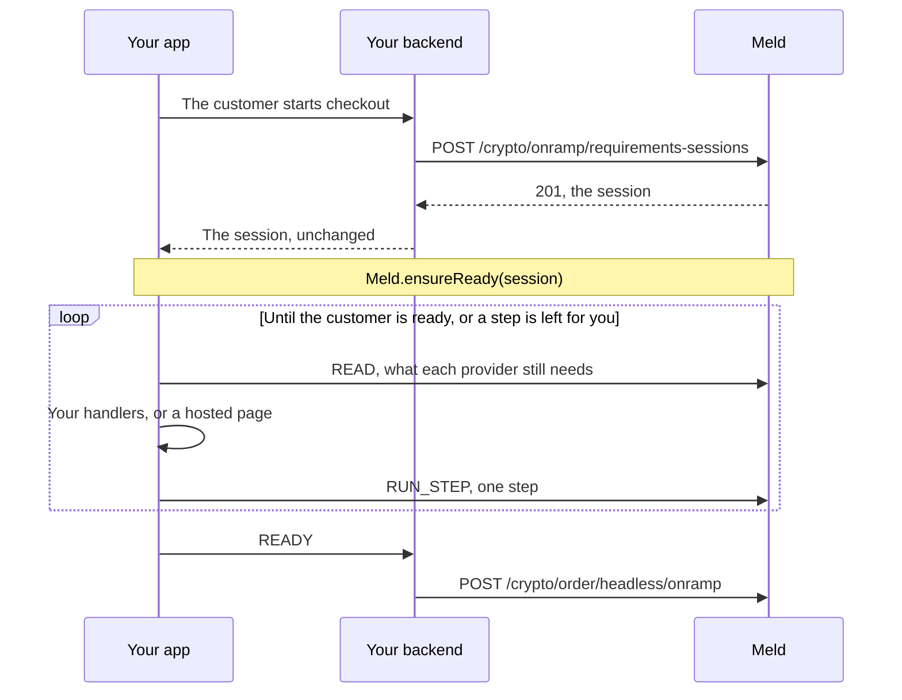

Before a provider takes an order, it may need things from the customer: a verified email or phone, its terms accepted, details on the customer, [Unified KYC](/docs/stablecoins/unified-kyc) at its [level](/docs/stablecoins/unified-kyc/kyc-levels), or its own hosted onboarding. The [requirements](/docs/stablecoins/headless-integration/shared-flows/eligibility#the-checklist) list them, one provider at a time. `Meld.ensureReady` works through them in your app or web page, for every provider you offer at once.

Your backend makes one call to start a session. Meld plans each step and makes each call. The SDK runs the steps, shows the hosted pages, and asks your UI only for what the customer has to type or agree to. Providers are data in the session, so your code doesn't branch on them, and your API key never leaves your backend.

| Platform | Package | From | Guide |
| --- | --- | --- | --- |
| Web | `@meldcrypto/sdk` | 0.9.0 | [Web SDK](/docs/stablecoins/headless-integration/sdks/web) |
| iOS | `MeldSDK` | 0.12.0 | [iOS SDK](/docs/stablecoins/headless-integration/sdks/ios) |
| Android | `io.meld:meldsdk` | 0.10.0 | [Android SDK](/docs/stablecoins/headless-integration/sdks/android) |
| React Native | `@meldcrypto/react-native-sdk` | 0.12.0 | [React Native SDK](/docs/stablecoins/headless-integration/sdks/react-native) |

<Note>
  Requirements sessions are enabled per account. In sandbox they are on for every account. For production, ask your Meld representative. Until they are on, creating a session answers `403 REQUIREMENTS_SESSIONS_NOT_ENABLED`.
</Note>

---

## How it works



1. Your backend [creates a session](#1-create-a-session-on-your-backend) for the customer and the providers you offer, and returns it to your app unchanged.
2. Your app [runs it](#2-run-it-in-your-app) with `Meld.ensureReady`, and handlers for what only your UI can do. On the web, the SDK's calls go through [a proxy on your backend](#on-the-web-proxy-the-calls).
3. You [act on the result](#3-act-on-the-result): create the order on `READY`, or show the customer what is left.

---

## 1. Create a session on your backend

**Endpoint:** [`POST /crypto/onramp/requirements-sessions`](/api-reference/crypto/headless/crypto-onramp-requirements-sessions-create)

**Header:** `Authorization: BASIC <your API key>`, from an API key that can create orders. The endpoint is unversioned: every `Meld-Version` answers the same.

```json
{
  "customerId": "W9kL817BBS7bNEwxAZaX4z",
  "serviceProviders": ["BANXA", "UPHOLD"],
  "order": {
    "paymentMethodType": "CREDIT_DEBIT_CARD",
    "sourceCurrencyCode": "USD",
    "sourceAmount": 250,
    "destinationCurrencyCode": "USDC",
    "destinationNetworkCode": "BASE",
    "countryCode": "US"
  },
  "readyWhen": "ALL"
}
```

| Field | Required | Description |
| --- | --- | --- |
| `customerId` | yes | The [Meld customer](/docs/stablecoins/headless-integration/shared-flows/eligibility#create-the-customer). Create it with an `externalId`: Meld can't record a terms acceptance for a customer without one |
| `serviceProviders` | yes | The providers you might create the order with, 1 to 5, each once. Usually the providers of the [quote rows](/docs/stablecoins/headless-integration/shared-flows/quotes#customer-readiness-on-each-row) you offer |
| `order` | no | The order you mean to create, whole or absent: `paymentMethodType`, `sourceCurrencyCode`, `sourceAmount`, `destinationCurrencyCode` and `countryCode`, plus `destinationNetworkCode` (required for Stripe) and `subdivision` when you have them. The same values as the [requirements' order parameters](/docs/stablecoins/headless-integration/shared-flows/eligibility#check-the-requirements). Without it, a provider that checks the order itself, such as Banxa, Uphold, Coinbase or Stripe, answers `UNDETERMINED` at best, never `READY`. Leave it out for a virtual account or an offramp: see [Virtual accounts and offramps](#virtual-accounts-and-offramps) |
| `readyWhen` | no | `ALL`, the default: ready when every provider is. `ANY`: ready when one is |

Response `201`:

```json
{
  "id": "Ny9YeB5gTh8WaQc3DrUf7k",
  "customerId": "W9kL817BBS7bNEwxAZaX4z",
  "serviceProviders": ["BANXA", "UPHOLD"],
  "readyWhen": "ALL",
  "expiresAt": "2026-11-04T15:28:30Z",
  "token": "<session token>",
  "requirementsActions": {
    "version": 1,
    "endpoint": "/crypto/onramp/requirements-sessions/Ny9YeB5gTh8WaQc3DrUf7k/actions",
    "bearerTokenPointer": "/token",
    "operations": [
      { "operation": "READ", "idempotencyKeyRequired": false },
      { "operation": "RUN_STEP", "idempotencyKeyRequired": true }
    ]
  }
}
```

Return it to your app unchanged. `token` is a bearer for this customer, these providers and this order, valid for 30 minutes (`expiresAt`). Never log or store it. Create a new session each time the customer starts again.

Create sessions only for your signed-in customer: never expose an endpoint that creates one for whatever `customerId` its caller names.

| Answer | Means |
| --- | --- |
| `400 REQUIREMENTS_SESSION_INVALID` | A missing or malformed `customerId`, no providers or more than five, a provider named twice or unknown, an `order` missing a required field, or a `readyWhen` other than `ALL` or `ANY` |
| `401` | No API key, or an invalid one |
| `403` | The API key can't create orders |
| `403 REQUIREMENTS_SESSIONS_NOT_ENABLED` | Sessions aren't enabled for your account in this environment |
| `403 SERVICE_PROVIDER_NOT_ENABLED` | A provider isn't enabled for headless orders on your account. See [Provider credentials](/docs/stablecoins/headless-integration#provider-credentials) |
| `404 CUSTOMER_NOT_FOUND` | Your account has no customer with that `customerId` |

---

## 2. Run it in your app

Configure the SDK for the environment your backend created the session in. The session names only a path, so the SDK sends its calls to the environment you configured, or on the web to your proxy, and can't tell a session created in another environment: Meld refuses it with `401`, so the run ends `EXPIRED`, after one call to `renewSession` when you pass it.

Then pass the session to `Meld.ensureReady` with your handlers:

<CodeGroup>

```js Web
import Meld from '@meldcrypto/sdk';

Meld.configure({ environment: 'sandbox', actionProxyUrl: '/api/meld' }); // see "On the web, proxy the calls"

const session = await fetch('/your-backend/requirements-session').then((r) => r.json());

const handle = Meld.ensureReady(session, {
  collect: (request) => askCustomer(request.fields, request.fieldErrors), // { key: value }, or null
  confirmAgreement: (terms) => showTerms(terms.url),                      // true only once accepted
  onPrompt: (prompt) => showContinue(() => prompt.proceed(), () => prompt.cancel()),
  renewSession: () => fetch('/your-backend/requirements-session').then((r) => r.json()),
});

const result = await handle.result;
if (result.status === 'READY' || result.status === 'UNDETERMINED') createOrder();
```

```swift iOS
import MeldSDK

Meld.configure(environment: .sandbox)

let session = try MeldRequirementsSession.from(jsonData: sessionJSON) // the 201 body, unchanged

let handle = Meld.ensureReady(session: session, handlers: MeldReadyHandlers(
    collect: { request, done in
        showForm(request.fields, errors: request.fieldErrors) { values in done(values) } // nil: you handled it
    },
    confirmAgreement: { agreement, done in
        showTerms(agreement.url) { accepted in done(accepted) }
    },
    renewSession: { done in
        fetchSession { data in done(data.flatMap { try? MeldRequirementsSession.from(jsonData: $0) }) }
    }
), presenter: self) { result in
    switch result.status {
    case .ready, .undetermined: createOrder()
    case .actionRequired: show(result.pending ?? [])
    default: report(result)
    }
}
```

```kotlin Android
Meld.configure(MeldEnvironment.SANDBOX)

val session = MeldRequirementsSession.fromJson(sessionJson) // the 201 body, unchanged

val handle = Meld.ensureReady(
    activity, // a ComponentActivity: destroying it cancels the run
    session,
    MeldReadyHandlers(
        collect = { request, answer -> showForm(request) { values -> answer(values) } }, // null: you handled it
        confirmAgreement = { request, answer -> showTerms(request.url) { accepted -> answer(accepted) } },
        renewSession = { answer -> fetchSession { json -> answer(json?.let(MeldRequirementsSession::fromJson)) } },
    ),
) { result ->
    when (result.status) {
        MeldReadyStatus.READY, MeldReadyStatus.UNDETERMINED -> createOrder()
        MeldReadyStatus.ACTION_REQUIRED -> show(result.pending)
        else -> report(result)
    }
}
```

```tsx React Native
import { Meld } from '@meldcrypto/react-native-sdk';

Meld.configure('sandbox');

const handle = Meld.ensureReady(session, {
  collect: (request) => showForm(request),              // the values by key, or null
  confirmAgreement: (request) => showTerms(request.url), // true once accepted
  renewSession: () => fetchSession(),                   // a new session, or null
});

const result = await handle.result;
if (result.status === 'READY' || result.status === 'UNDETERMINED') createOrder();
```

</CodeGroup>

The SDK reads what each provider still needs, runs the first step it can, and reads again, until the customer is ready or a step is left that it can't run. On Android, the types are in `io.meld.sdk.requirements`.

### Handlers

| Handler | Called for | Answer with |
| --- | --- | --- |
| `collect` | Details the customer types: a contact or a code, their name or address, or a provider's questions | The value for each field `key`, as strings. `null` when you handled the step yourself, and the SDK reads again |
| `confirmAgreement` | A provider's terms, with the document's `url` to show | `true` only once the customer accepted. Anything else ends the run `ACTION_REQUIRED` |
| `presentUrl` | A hosted page, when you show pages yourself | Done once the page is closed. Replaces the SDK's own presenter |
| `renewSession` | The session expired during the run | A new session for the same customer from your backend. Without one, the run ends `EXPIRED` |
| `onProgress` | Each change of state: `READING`, `RUNNING`, `AWAITING_INPUT`, `PRESENTING` or `WAITING`, with the latest read as `snapshot` | Nothing. Use it for a progress indicator |
| `onPrompt` | Web only: a hosted page is about to open | See [Hosted pages](#hosted-pages) |

On the web, a handler returns a Promise. On iOS and Android, it calls the completion it is given, once. On React Native, it returns a value or a Promise, and a `collect`, `confirmAgreement` or `renewSession` that leaves a request unanswered for 10 minutes ends the run `CANCELLED`. `presentUrl` has no such limit, since a customer can take longer on a hosted page.

A step whose handler you leave out isn't run: the run ends `ACTION_REQUIRED`, with the step in `pending`. **The SDK never accepts terms on its own.**

### What `collect` receives

`collect` gets `{ stepId, type, code, serviceProviders, fields, reason?, fieldErrors? }`. Each field is `{ key, label?, fieldType?, jsonSchema?, allowedValues? }`. Collect every field of a request in one pass, and answer with exactly those keys. Meld checks each value before it calls anyone:

| `key` | Meld takes |
| --- | --- |
| `email` | 3 to 254 characters: one `@`, a dot in the part after it, and no spaces, for example `ada@example.com` |
| `phone` | A `+`, then 8 to 15 digits with the country code, the first not `0`, for example `+14155550100` |
| `otp` | The code the customer received, 4 to 10 digits |
| `name.firstName`, `name.lastName` | 1 to 100 characters |
| `address.lineOne`, `address.city` | 1 to 200 characters |
| `address.postalCode` | 1 to 20 characters |
| `address.countryCode` | ISO 3166-1 alpha-2, in capitals, for example `US` |
| A provider's own key | One of `allowedValues` when the field has them, otherwise 1 to 1024 characters |
| A provider's questionnaire, such as Uphold's `customerDueDiligence` or `taxDetails` | The answers to the part it asks now, as the text of one JSON object, up to 32768 characters |

A provider's questionnaire, such as Uphold's due-diligence and tax questions, comes one part at a time. Each field is one questionnaire: its `key` names it, and its `jsonSchema` is the JSON Schema of the one part to answer now, as text, with that part as its only property, for example `{"type":"object","maxProperties":1,"properties":{"employment":{…}},"required":["employment"]}`. Answer with the text of a JSON object that holds only that part and meets the schema, for example `{"employment":{"status":"employed"}}`. Never send a part again once it is answered. Meld checks only that the value is one JSON object, so check it against the schema yourself before you answer. The next read offers the next part, and `collect` is called again until the questionnaire is done. A questionnaire the provider gives no schema for, such as Uphold's proof of address, is never a field: see [What the SDK runs](#what-the-sdk-runs).

When Meld refuses a value, `collect` is called again for the same request, with `fieldErrors`: `[{ key, reason }]`, where `reason` is `REQUIRED` for a key left out, `INVALID` for a value Meld refuses, or `UNSUPPORTED` for a key the step doesn't take. It never carries the value. `INVALID` is also the answer when Meld can't save a value the customer typed, so `collect` asks again rather than the run failing. The same goes for a contact or a code the customer typed. After the fourth refused answer to the same request, the run ends `ACTION_REQUIRED` with that step.

### Verifying a contact

A `VERIFY_CONTACT` step has Meld send the customer a code, and asks for it back. Take a customer with `ada@example.com` on file and no phone, and Coinbase, which needs both verified. `collect` is called four times:

| Call | `collect` receives | You answer |
| --- | --- | --- |
| 1 | `{ stepId: 'COINBASEPAY:VERIFICATION:EMAIL', type: 'VERIFICATION', code: 'EMAIL', serviceProviders: ['COINBASEPAY'], fields: [{ key: 'otp' }] }`, once Meld has sent a code to the email on file | `{ otp: '000000' }`, a wrong code |
| 2 | The same, with `fieldErrors: [{ key: 'otp', reason: 'INVALID' }]` | `{ otp: '123456' }` |
| 3 | `{ stepId: 'COINBASEPAY:VERIFICATION:PHONE', type: 'VERIFICATION', code: 'PHONE', serviceProviders: ['COINBASEPAY'], fields: [{ key: 'phone' }] }`, since no phone is on file | `{ phone: '+14155550100' }` |
| 4 | The same step, with `fields: [{ key: 'otp' }]`, once Meld has sent a code to that phone | `{ otp: '654321' }` |

The run then ends `READY`.

Meld sends the code to the contact on file. It takes a contact the customer types only while the customer has none for that channel, and saves it on the customer once the customer confirms its code. It never replaces a contact on file: if a different one is put on file while the customer types, Meld refuses the typed one with `UNSUPPORTED`. A code that can no longer be confirmed, because it expired, was used, or a newer code replaced it, isn't asked for again: the SDK reads again, and the run ends `ACTION_REQUIRED` with the step. Run `ensureReady` again, and it sends a new code.

### What the SDK runs

Each step comes from a [checklist step](/docs/stablecoins/headless-integration/shared-flows/eligibility#steps) of one or more providers, and its `kind` says what running it takes:

| `kind` | For | What the SDK does |
| --- | --- | --- |
| `VERIFY_CONTACT` | A contact the provider needs verified (`VERIFICATION`) | Has Meld send a code. Calls `collect` for `email` or `phone` when the customer has none on file, then for `otp`. See [Verifying a contact](#verifying-a-contact) |
| `AGREE` | A provider's terms (`AGREEMENT`) | Calls `confirmAgreement`, and records the acceptance only on `true` |
| `COLLECT` | Details the provider needs on the customer (`CUSTOMER_DETAILS`), and the provider's own questions (`PROVIDER_EXTRA_FIELDS`), including questionnaires such as Uphold's due-diligence and tax questions | Calls `collect`, then sends the values. A questionnaire comes back, one part at a time, until it is done |
| `SUBMIT` | Unified KYC (`MELD_KYC`), the share with a provider (`PROVIDER_KYC_SHARE`), or a provider's process (`PROVIDER_PROCESS`), such as Coinbase's `limitUpgrade` | Runs it. Unified KYC answers with the Sumsub page, and a process can answer with the provider's own form page. The SDK shows them as [hosted pages](#hosted-pages) |
| `OPEN_URL` | A provider's hosted onboarding or hosted terms, such as Noah's or Due Network's | Shows the page, then has Meld check it |

A step the providers share runs once: one email for all of them, and Unified KYC once, at the highest level among them. A step that belongs to a provider, such as its terms or its onboarding, runs for that provider. Meld never renders a form: your UI asks every question, including a provider's questionnaire, from the fields in `collect`.

Meld adds the customer and the order to every call, from the session. It records a terms acceptance itself, with its own clock and the IP address the call came from: on the web, your proxy's (see [On the web, proxy the calls](#on-the-web-proxy-the-calls)). A contact the customer types is saved on the customer only once they confirm its code: see [Verifying a contact](#verifying-a-contact).

The SDK doesn't run:

- `WAIT` steps, such as a review. It reads again until they clear: see [Waiting on a review](#waiting-on-a-review).
- `UNKNOWN` steps. Meld answers them on a later read.
- Steps no app can run: a detail only the provider's own page collects, a provider's questions that include a document, such as Banxa's proof of address (a field whose `fieldType` is `OBJECT`), for which the SDK has no upload, or a questionnaire the provider gives no schema for, such as Uphold's proof of address. `providers[].open` lists them. When nothing else is left to run or wait for, the run ends `ACTION_REQUIRED` at once, with an empty `pending`.
- Steps that run inside the order (`ORDER_CONTINUATION`). The result lists them in `continuation`: see [READY, then the order](#ready-then-the-order).

### Hosted pages

Unified KYC, a provider's hosted onboarding or terms, and a provider's form page are pages the customer completes in a browser. Closing a page never counts as done: the next read decides.

- A provider's onboarding or terms link that expires within a minute is refreshed before the page opens. That includes a link that aged while the web or iOS prompt was open: the SDK refreshes it at the tap and opens the new one, and never asks the customer twice.
- When the customer closes such a page, or it fails to load, the SDK refreshes the step once, which also tells Meld what the customer did there, then reads. A `409` on that refresh isn't an error: the SDK reads as usual. A `401` on it calls `renewSession` and sends the refresh once more on the new session, without opening the page again; a second `401` ends the run `EXPIRED`.
- When the SDK closes the page itself, because Meld reports the step done, it only reads.
- Unified KYC's page and a provider's form page come from running a step, and are never refreshed: the SDK reads once they close.
- A page closed with its step unfinished isn't opened again while the checklist stays the same apart from its link: if the step is still left 30 seconds later, the run ends `ACTION_REQUIRED` with that step.

| Platform | How the page opens | When the SDK closes it |
| --- | --- | --- |
| Web | The SDK asks you first, through `onPrompt({ kind: 'OPEN_URL', stepId, serviceProviders, proceed, cancel })`. Show a button and call `proceed()` from its click: the page opens in a popup without access to your page. If an onboarding or terms link has less than a minute left by then, the SDK refreshes it within the click and opens the new one in the same popup. `cancel()` ends the run `ACTION_REQUIRED`. Or pass `{ host: element }` as the third argument of `ensureReady`: the page fills an iframe in that element, with `allow="camera; microphone; clipboard-write"`, and you call `handle.refresh()` when the customer says they're done. Your `frame-src` must then allow your providers' pages | When Meld reports the step done, it closes the popup or removes the iframe |
| iOS | The customer taps Continue on a prompt, then the page opens in Safari View Controller over `presenter`, or over the top view controller. Cancel ends the run `ACTION_REQUIRED`. If an onboarding or terms link has less than a minute left by then, the SDK refreshes it after the tap and opens the new one, without a second prompt | When Meld reports the step done |
| Android | In a Custom Tab, or in the browser when no browser on the device offers Custom Tabs. The page counts as closed when your activity resumes: the SDK doesn't read while the page is open, `handle.refresh()` does nothing then, and the SDK carries on when the customer comes back | Never: a Custom Tab can't be closed by the app. On a device with no browser, the run ends `ACTION_REQUIRED` |
| React Native | The native SDK's presenter, as on iOS and Android | As on iOS and Android |

On every platform, `presentUrl` replaces the SDK's presenter: show `url` your way, and answer once the page is closed. On the web, without `onPrompt`, `host` or `presentUrl`, the SDK can't open a page, Unified KYC's included, so those steps end the run `ACTION_REQUIRED`.

---

## 3. Act on the result

On the web and React Native, `handle.result` is a Promise that never rejects. On iOS and Android, `onResult` is called once, on the main thread.

| `status` | Means | Do |
| --- | --- | --- |
| `READY` | Every provider is ready, or one is with `readyWhen: ANY` | Create the order. See [READY, then the order](#ready-then-the-order) |
| `UNDETERMINED` | Meld couldn't tell | Create the order: order creation has the final word |
| `PENDING` | Only reviews are left, and `waitTimeoutMs` passed | Wait for the `CUSTOMER_KYC_STATUS_CHANGE` webhook, then run `ensureReady` again |
| `ACTION_REQUIRED` | A step is left that this run couldn't do: no handler for it, the customer declined terms or a page, values refused four times, or a page closed with the step unfinished. Or the only steps left are ones no app can run, and `pending` is empty | Show `pending`, or `providers[].open` when `pending` is empty, then run `ensureReady` again |
| `BLOCKED` | A provider refuses this customer or order | Offer another provider. See [Several providers](#several-providers-in-one-session) |
| `EXPIRED` | The session expired, or was created in another environment, and `renewSession` gave no new one that Meld takes | Create a new session |
| `CANCELLED` | You called `handle.cancel()`. On Android, also when the activity is destroyed. On React Native, also when `collect`, `confirmAgreement` or `renewSession` leaves a request unanswered for 10 minutes | Nothing |
| `FAILED` | `error` says why | See [Errors](#errors) |

The result has the same members on every platform:

| Member | Holds |
| --- | --- |
| `status` | As above. Treat a value you don't know as not ready |
| `providers` | Each session provider's `serviceProvider`, `status`, `eligible` (`true`, `false` or `null`), and `open`: its steps before the order that aren't `SATISFIED` yet, each `{ type, code, status, reason?, errorCodes? }`. `errorCodes` holds the provider's codes on a share it refused, such as Coinme's `PHONE_VERIFICATION_REQUIRED`. The SDK acts on none of them |
| `pending` | `ACTION_REQUIRED` only: the steps left, each `{ stepId, kind, type, code, serviceProviders, level?, url?, expiresAt?, fields?, reason? }`. Empty when the only steps left are ones no app can run: `providers[].open` names them |
| `continuation` | The steps a provider declares to run inside the order once you create it, today only Stripe's identity check, each `{ serviceProvider, code, nextStep? }` |
| `error` | `FAILED` only: `{ kind, status?, code? }` |

`status`, `kind` and the step types are open sets. Never log `pending`: a step's `url` opens the customer's own page.

### READY, then the order

`READY` means every step before the order is done. Create the order with [`POST /crypto/order/headless/onramp`](/api-reference/crypto/headless/crypto-order-headless-onramp-create), with the values of the session's `order`, then [mount it](/docs/stablecoins/headless-integration/sdks#check-before-you-mount). For a virtual account or an offramp, see [Virtual accounts and offramps](#virtual-accounts-and-offramps).

`READY` doesn't mean nothing is left. `continuation` lists the steps a provider declares to run inside the order: today only Stripe's identity check (`nextStep: SDK_VERIFY_IDENTITY`). Other providers' own pages, such as Mercuryo's widget or Coinbase's payment page, aren't listed: they open when you mount the order. The SDK runs all of them once you mount the order, and they need nothing from you before you create it.

If order creation still refuses, see [When order creation refuses](/docs/stablecoins/headless-integration/shared-flows/eligibility#when-order-creation-refuses): create a new session and run `ensureReady` again.

### Virtual accounts and offramps

A session also gets a customer ready for a virtual account (deposit instructions) or an offramp, for example with Noah or Due Network: their hosted onboarding and terms are `OPEN_URL` steps the SDK runs. Create the session without `order`: it describes a headless onramp order, and with it Meld also checks that the order can be created, which deposit instructions and a sell order don't need. On `READY`, [fetch the deposit instructions](/docs/stablecoins/virtual-account-integration/payins#6-fetch-virtual-account-details), or [create the sell order](/docs/stablecoins/virtual-account-integration/payouts#5-create-a-headless-offramp-order).

Noah and Due Network also take headless onramp orders. To get a customer ready for one, create the session with `order`, as for any provider, and create the order on `READY`.

### Waiting on a review

While only reviews are left, such as Unified KYC's or a provider's, the SDK reads again as often as Meld asks, every 2 to 30 seconds. Whatever Meld answers, it reads at most once a second and at least once a minute, and every 4 seconds when Meld doesn't say. It waits for `waitTimeoutMs`, 10 minutes by default, then ends `PENDING`. Set it in the options: `{ waitTimeoutMs }` on the web and React Native, `MeldReadyOptions(waitTimeoutMs: …)` on iOS, `MeldReadyOptions(waitTimeoutMs = …)` on Android.

Your backend learns a review's outcome from the [`CUSTOMER_KYC_STATUS_CHANGE` webhook](/docs/stablecoins/for-all-products/webhook-events#customer_kyc_status_change). If you relay it to the app, for example through a push notification or your own socket, call `handle.refresh()`: the SDK reads at once instead of at the next poll. It ends a wait, never the delay before a retry, and on Android it does nothing while a page is open. After `PENDING`, run `ensureReady` again on the next webhook, with a new session once this one has expired.

`handle.cancel()` stops the run and ends it `CANCELLED`, even while a handler waits for an answer or a page is open. No handler is called after the result, even when `onProgress` itself calls `cancel()`.

### Several providers in one session

Name up to five providers. The steps they share run once, Unified KYC at the highest level among them, so the customer verifies once for all of them.

- With `readyWhen: ALL`, the result is `READY` when every provider is, and `BLOCKED` as soon as one is. `providers` says which: create the next session without it.
- With `readyWhen: ANY`, the result is `READY` when one provider is, and `BLOCKED` only when all are. `providers` says which are ready: create the order with one of them.

### Errors

Before it gives up, the SDK retries the same way on every platform:

| When | The SDK | If that doesn't help, the run ends |
| --- | --- | --- |
| A call fails in transit | Sends it again with the same idempotency key, 1, 2 and 4 seconds later | `FAILED` with `{ kind: 'transport' }` |
| Meld answers `425 OPERATION_IN_FLIGHT` | Sends it again with the same key every second, up to 5 times | `FAILED` with `425 OPERATION_IN_FLIGHT` |
| Meld answers `503 OUTCOME_UNKNOWN` | Reads first, every time. If Meld no longer offers the step, it carries on from that read. If it does and the step opens a page, it refreshes the page with a new key, up to 3 times for each step. Any other step may have run, for example a code sent or an address saved, so the SDK doesn't send it again | `ACTION_REQUIRED`, with that step. `FAILED` with `503 OUTCOME_UNKNOWN`, if Meld still offers a page after the third refresh |
| Meld answers `400` with `fieldErrors`, to a value the customer typed | Calls `collect` again with `fieldErrors`, up to 3 times for each value it asks for | `ACTION_REQUIRED`, with that step |
| Meld answers `401`: the session expired | Calls `renewSession` and carries on with the new session. It calls it again only once a later call has succeeded, and at most 3 times in one run. A read while a page is open doesn't count as a success | `EXPIRED`, on a second `401` before any call succeeds, on a `401` after the third renewal, when `renewSession` gives no session, or at once without `renewSession` |
| Meld answers `409` or `422`: the step was done elsewhere, changed, or was refused, another run of it hasn't finished, or a code can no longer be confirmed | Reads again, and carries on from there | `ACTION_REQUIRED`, if the same step is still left |

On the web and iOS, the SDK reads every `pollAfterMs` while a page is open, only to decide when to close it. A read that fails there is ignored: it isn't retried, doesn't call `renewSession` and doesn't count toward any limit, and the next read comes at the next poll. The limits above count from the refresh or read after the page closes. Android doesn't read while a page is open.

`{ kind: 'protocol' }` means the SDK couldn't use the session or read Meld's answer. On React Native it also means the app binary predates the native support, or on Android that no `ComponentActivity` is on screen.

`{ kind: 'http' }` carries the HTTP `status` and, when Meld sent one, the `code`:

| `status` and `code` | Means | Do |
| --- | --- | --- |
| `429 PROVIDER_RATE_LIMITED` | Too many codes sent to the same contact | Wait, then run `ensureReady` again |
| `502 PROVIDER_UNAVAILABLE`, `502 INVALID_PROVIDER_RESPONSE` | Meld or the provider couldn't be reached, or answered with something unusable. Nothing changed | Run `ensureReady` again later |
| `503 OUTCOME_UNKNOWN` | A page's refresh stayed unknown after the SDK read and refreshed it 3 times | Run `ensureReady` again: it reads before it runs anything |
| `425 OPERATION_IN_FLIGHT` | Another run of the same step didn't finish | Run `ensureReady` again shortly |
| `404 STATE_NOT_FOUND` | The customer, or a record a step needs, is gone | Check the customer |
| `400 INVALID_REQUEST` | Meld refused what the SDK sent | Contact your Meld representative, with the SDK version |
| `403` or `404` without a `code`, on the web | Your proxy refused the session path | Add it to your proxy: see [On the web, proxy the calls](#on-the-web-proxy-the-calls) |

---

## On the web, proxy the calls

The SDK posts each read and each step to the session's `requirementsActions.endpoint`, with the session token as the bearer. The Meld API accepts these calls from a browser only on Meld's own origins, so a page on your origin sends them through a proxy on your backend. Configure its path once:

```js
Meld.configure({ environment: 'production', actionProxyUrl: '/api/meld' });
```

The SDK then posts to `location.origin + actionProxyUrl + endpoint`, for example `https://your.app/api/meld/crypto/onramp/requirements-sessions/Ny9YeB5gTh8WaQc3DrUf7k/actions`. `actionProxyUrl` is a path on your page's origin. Native apps call Meld directly, and need no proxy.

The proxy must:

- Accept `POST {actionProxyUrl}/crypto/onramp/requirements-sessions/{sessionId}/actions`, where `sessionId` is 1 to 64 base58 characters (`^[1-9A-HJ-NP-Za-km-z]{1,64}$`), and forward it to the same path on the Meld API: `https://api-sb.meld.io` in sandbox, `https://api.meld.io` in production. Forward no other path, so the proxy can't become an open relay.
- Forward only the `Authorization`, `Content-Type` and `X-Idempotency-Key` headers. **Don't add your API key**: the session token is the credential. Don't forward `Origin`, `Cookie` or `Referer`.
- Cap the request body at 64 KiB, follow no redirects, and return Meld's status and body unchanged, with `Cache-Control: no-store`. An answer can be up to 256 KiB.
- **Never log a body** in either direction. They carry links to the customer's hosted pages and the details the customer typed.

It may add one `X-Meld-End-User-Ip` header with the customer's IP address. Meld uses it only as evidence for terms the customer accepts, recorded as `MELD_SDK_PROXY`, and only once Meld enables it for your account: ask your Meld representative. Until then, or when the header isn't one IP address, Meld records the address the call came from, which is your proxy's.

<Warning>
  **Already running an `actionProxyUrl` proxy?** Add the session path to it before you upgrade to Web SDK 0.9.0. Until you do, `ensureReady` ends `FAILED` with your proxy's `403` or `404`.
</Warning>

---

## A hosted verification on a refused order

Some refusals of [`POST /crypto/order/headless/onramp`](/api-reference/crypto/headless/crypto-order-headless-onramp-create) come with a page where the customer can finish verifying, in `serviceProviderDetails.hostedVerificationUrl`. Mercuryo's `403 KYC_NOT_COMPLETED` for a customer new to Mercuryo in the US is one. Open it with `Meld.openHostedVerification` from the customer's tap, then create the order again with a new `externalOrderId`. The refused order stays refused.

<CodeGroup>

```js Web
button.onclick = async () => {
  const page = Meld.openHostedVerification(refusal.serviceProviderDetails.hostedVerificationUrl);
  await page.closed;
  createOrderAgain(); // with a new externalOrderId
};
```

```swift iOS
Meld.openHostedVerification(url: url, presenter: self) {
    createOrderAgain() // with a new externalOrderId
}
```

```kotlin Android
Meld.openHostedVerification(activity, url) {
    createOrderAgain() // with a new externalOrderId
}
```

```tsx React Native
await Meld.openHostedVerification(refusal.serviceProviderDetails.hostedVerificationUrl);
await createOrderAgain(); // with a new externalOrderId
```

</CodeGroup>

| Platform | Opens the page | Refuses |
| --- | --- | --- |
| Web | In a popup without access to your page. With `{ host: element }` as the second argument, in an iframe in that element instead, which you close with `page.close()` once the customer is done. `closed` settles when the page closes | A URL that isn't `https`, with a `TypeError`. A popup the browser blocks throws, so call it from a click |
| iOS | In Safari View Controller, after the Continue prompt. `onClose` runs when it closes | A URL that isn't `https`: nothing opens, and `onClose` runs at once. The same happens when nothing is on screen to present from |
| Android | In a Custom Tab, or in the browser. `onClose` runs when your activity resumes | A URL that isn't `https`, with `IllegalArgumentException`. No app on the device to open it, with `ActivityNotFoundException` |
| React Native | As on iOS and Android. The Promise resolves when the page closes | A URL that isn't `https`, with a `TypeError`. On Android, it rejects with `code` `presentation_unavailable` when no activity is on screen or no app can open the page. On iOS, it resolves at once when nothing is on screen to present from |

Closing the page doesn't mean the customer passed: the next order creation decides. Never log or store the URL.

---

## Reference

<CodeGroup>

```ts Web
Meld.ensureReady(session: MeldRequirementsSession, handlers?: MeldReadyHandlers, options?: MeldReadyOptions): MeldReadyHandle
// MeldReadyHandle: { result: Promise<MeldReadyResult>; refresh(): void; cancel(): void }
// MeldReadyHandlers: { onProgress?, collect?, confirmAgreement?, onPrompt?, presentUrl?, renewSession? }
// MeldReadyOptions: { waitTimeoutMs?: number; host?: Element }
Meld.openHostedVerification(url: string, options?: { host?: Element }): { closed: Promise<void>; close(): void }
```

```swift iOS
MeldRequirementsSession.from(jsonData: Data) throws -> MeldRequirementsSession // or from(jsonString:)
Meld.ensureReady(session: MeldRequirementsSession, handlers: MeldReadyHandlers,
                 options: MeldReadyOptions = .init(), presenter: UIViewController? = nil,
                 onResult: @escaping (MeldReadyResult) -> Void) -> MeldReadyHandle // refresh(), cancel()
MeldReadyHandlers(onProgress:collect:confirmAgreement:presentUrl:renewSession:) // each optional
MeldReadyOptions(waitTimeoutMs: Int = 600_000)
Meld.openHostedVerification(url: URL, presenter: UIViewController? = nil, onClose: @escaping () -> Void)
```

```kotlin Android
MeldRequirementsSession.fromJson(json: String): MeldRequirementsSession // throws MeldRequirementsSessionException
Meld.ensureReady(activity: ComponentActivity, session: MeldRequirementsSession, handlers: MeldReadyHandlers,
                 options: MeldReadyOptions = MeldReadyOptions(), onResult: (MeldReadyResult) -> Unit): MeldReadyHandle
MeldReadyHandlers(onProgress, collect, confirmAgreement, presentUrl, renewSession) // each optional
MeldReadyOptions(waitTimeoutMs: Long = 600_000)
Meld.openHostedVerification(activity: ComponentActivity, url: String, onClose: () -> Unit)
```

```ts React Native
Meld.ensureReady(session: object, handlers?: MeldReadyHandlers, options?: { waitTimeoutMs?: number }): MeldReadyHandle
// MeldReadyHandle: { result: Promise<MeldReadyResult>; refresh(): void; cancel(): void }
// MeldReadyHandlers: { onProgress?, collect?, confirmAgreement?, presentUrl?, renewSession? }
Meld.openHostedVerification(url: string): Promise<void>
```

</CodeGroup>

| Platform | Notes |
| --- | --- |
| Web | `ensureReady` throws a `TypeError` for a session it can't use, a handler that isn't a function, or a bad option. It needs the [proxy](#on-the-web-proxy-the-calls) |
| iOS | `from` throws `MeldRequirementsSessionError.malformed` for a body that isn't a session. Handlers and `onResult` run on the main queue. Releasing the handle doesn't stop the run: call `cancel()` |
| Android | `fromJson` throws `MeldRequirementsSessionException` for a body that isn't a session. Call `ensureReady` on the main thread. Handlers and `onResult` run on the main thread, and you may answer a handler from any thread, once. 0.10.0 adds `androidx.activity` 1.9.3 as an API dependency, `androidx.browser` 1.8.0, and package queries for Custom Tabs and for `https` browsers. Once the result is delivered, the handle holds neither your handlers nor the activity, so you can keep it, for example in a `ViewModel` |
| React Native | `ensureReady` throws a `TypeError` for a session that isn't an object, a handler that isn't a function, or a bad `waitTimeoutMs`. The native SDK asks for only the handlers you pass, `renewSession` included. A handler that throws or answers something malformed counts as `null` from `collect` and `renewSession`, `false` from `confirmAgreement`, and a closed page from `presentUrl`. It needs a native build with `MeldSDK` 0.12 and `io.meld:meldsdk` 0.10.0: an over-the-air update can't add it, and on an older binary `ensureReady` ends `FAILED` with `protocol` at once. `cancel()` ends the run `CANCELLED` at once, with an empty `providers`. Once `result` resolves, the handle holds none of your handlers, so you can keep it, for example in a store |

The SDKs never log the session token, a hosted page's link, or anything `collect` returns.
