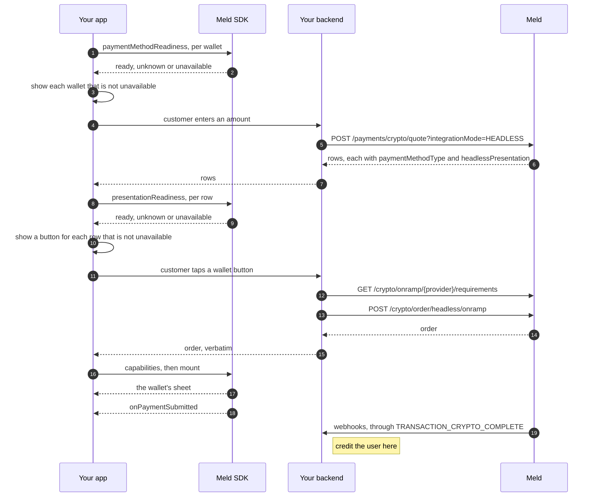

A wallet order is a headless order paid on a wallet's own sheet, such as Apple Pay or Google Pay. Your backend quotes and creates it, the [Meld SDK](/docs/stablecoins/headless-integration/sdks) presents the wallet's sheet, and settlement arrives by webhook. The calls are the same for every wallet and for every provider behind them: one create call, one `mount`, the same callbacks and webhooks. Your app hands each quote row and each order to the SDK, and the SDK decides how to present it, so your code has no provider or platform branches. The provider only changes what you set up once and what the customer needs before the order.

<Note>
  iOS SDK 0.10.0, Android SDK 0.8.0, React Native SDK 0.10.0 and Web SDK 0.7.0 are the releases that bring the wallet contract on this page: the readiness checks and the shared error codes. Where older releases behave differently, the section says so.
</Note>

---

## What runs where

Apple Pay orders use `paymentMethodType: APPLE_PAY`, and Google Pay orders `GOOGLE_PAY`.

| Wallet | Provider | [iOS SDK](/docs/stablecoins/headless-integration/sdks/ios) | [Android SDK](/docs/stablecoins/headless-integration/sdks/android) | [React Native SDK](/docs/stablecoins/headless-integration/sdks/react-native) | [Web SDK](/docs/stablecoins/headless-integration/sdks/web) |
| --- | --- | --- | --- | --- | --- |
| Apple Pay | Mercuryo | Yes | No | On iOS | No |
| Apple Pay | Banxa | Yes | No | On iOS | Yes, in a browser with Apple Pay |
| Apple Pay | Stripe | Yes | No | On iOS | Not yet |
| Apple Pay | Coinbase | On iOS 16 or later | No | On iOS 16 or later | Not yet |
| Google Pay | Coinbase | No | 0.7.0 or later | On Android, from 0.9.0 | No |

The quote returns only the providers that can take the order headlessly for that customer's country, currency and method. Who can pay through each provider, and what they need before the order, is in [Providers](#providers).

Apple Pay never runs on Android, and Google Pay never runs on iOS or the web. Every SDK reports a combination it doesn't present as unavailable, so the [readiness checks](#1-check-the-device-then-quote) hide it without a platform check of yours.

---

## Providers

| Provider | Wallets | Customers | Before the order | Your setup | The customer sees |
| --- | --- | --- | --- | --- | --- |
| Mercuryo, Banxa | Apple Pay | Countries in the quote | [Unified KYC](/docs/stablecoins/unified-kyc) | Merchant identifier, certificate from Meld's CSR | The Apple Pay sheet |
| Stripe | Apple Pay | US except New York, paying USD | [Unified KYC](/docs/stablecoins/unified-kyc), and an email on the customer | Merchant identifier, certificate from Stripe's CSR | Stripe's Link sign-in and identity checks, then the Apple Pay sheet |
| Coinbase | Apple Pay, Google Pay | US, paying USD | A verified email and US mobile number, and Coinbase's agreements | Google Pay: your app's approval | The wallet's sheet |

[Eligibility](/docs/stablecoins/headless-integration/shared-flows/eligibility) tells you what a provider still needs for a given customer, so you don't have to hardcode the column above.

### Stripe

- **Credentials.** In production, Stripe orders run on your own Stripe account. Stripe onboards it for its embedded crypto onramp and registers your app as a trusted application. Then add your Stripe keys to your Meld account as in [provider setup](/docs/stablecoins/for-all-products/service-provider-setup), together with the Link OAuth client ID, client secret and headless API version Stripe gives you, and point a Stripe webhook for `crypto.onramp_session.updated` at the webhook URL the Meld dashboard shows for the integration. In sandbox, Meld provides the Stripe integration: see [Headless testing](/docs/stablecoins/sandbox-guide/headless-testing#apple-pay-with-stripe).
- **Link.** Stripe signs the customer in to Link with the email on the Meld customer, and sends the one-time code to the phone on that Link account.
- **Identity.** Stripe runs its own KYC, and the SDK fills it from Unified KYC, so the customer only types their SSN. Meld doesn't refuse a Stripe order without Unified KYC, but the customer then fills in Stripe's forms by hand. Stripe can also ask for an ID document or a selfie, depending on the amount and its own risk checks.
- **Cards.** `CREDIT_DEBIT_CARD` runs the same flow, with Stripe collecting the card. It needs no Apple setup.

### Coinbase

- **Credentials.** In production, Coinbase orders run on your own Coinbase Developer Platform project. See [provider credentials](/docs/stablecoins/headless-integration#provider-credentials).
- **Merchant of record.** Coinbase takes the payment on its own payment page, and the SDK opens the wallet's sheet from it. You need no Apple setup.
- **Before the order.** Verify the email and phone with `serviceProvider: "COINBASEPAY"`, and record the customer's acceptance of Coinbase's agreements. Both are in [Eligibility](/docs/stablecoins/headless-integration/shared-flows/eligibility).
- **Limits.** Coinbase caps each customer weekly and over their lifetime. Over the lifetime cap, the order is refused with `CUSTOMER_NOT_PAYMENT_READY` until the customer completes the `limitUpgrade` [process](/docs/stablecoins/headless-integration/shared-flows/eligibility#provider-processes).
- **Quote.** Send `walletAddress` on the [headless quote](/docs/stablecoins/headless-integration/shared-flows/quotes), so Coinbase prices the same checkout the order uses.
- **Settlement.** Meld creates the transaction once Coinbase reports the payment, usually a minute or more after `onPaymentSubmitted`. An order the customer never pays sends no webhook.
- **Sandbox.** For Apple Pay, sandbox covers everything up to creating the order. The current SDKs can't present a sandbox Coinbase Apple Pay order (it ends in `PRESENTATION_FAILED`), so test the sheet in production with a small order. Google Pay runs in sandbox: see [Google Pay in sandbox](#google-pay-in-sandbox).

#### Google Pay with Coinbase

The SDK loads Coinbase's payment page out of sight and presses its Google Pay button once, so the customer sees only Google Pay's sheet, with Coinbase as the merchant.

- **Availability.** Google Pay rows appear in your quotes when Google Pay is live for the providers on your account. For Coinbase, Google Pay must also be enabled on your Coinbase project.
- **Order.** `serviceProvider: "COINBASEPAY"` and `paymentMethodType: "GOOGLE_PAY"`, as in [step 3](#3-check-eligibility-then-create-the-order). The order comes back with `headlessPresentation` `PROVIDER_HOSTED` / `COINBASE_PAYMENT_LINK` / `1`, which the SDK reads.
- **Clients.** Android SDK 0.7.0 or later, or React Native SDK 0.9.0 or later on Android. Prefer Android SDK 0.8.0 or React Native SDK 0.10.0, for the readiness checks and the Activity mount.
- **After `onPaymentSubmitted`.** You can unmount straight away. The SDK keeps Coinbase's page alive for up to 60 seconds, so Coinbase can finish confirming the payment.

The SDK reports the events of Coinbase's page (`onramp_api.*`) like this. The provider's event and code travel in `detail`.

| Coinbase reports | You get |
| --- | --- |
| `load_success` | `onReady` |
| `commit_success` or `polling_start` | `onStatusChange(pending)`, then `onPaymentSubmitted` |
| `cancel` | `onCancel` |
| `ERROR_CODE_GUEST_GOOGLE_PAY_NOT_SUPPORTED` | `onError(PAYMENT_METHOD_UNAVAILABLE)` |
| `ERROR_CODE_INIT` | `onError(ORDER_STATE_CHANGED)` |
| `commit_error` | `onError(PAYMENT_REJECTED)` |
| `polling_error` | `onError(PAYMENT_OUTCOME_UNKNOWN)` |
| Any other error, or no sheet within 8 seconds of the press (`detail` `presentation_deadline`) | `onError(PRESENTATION_FAILED)` |
| The session ends once the sheet may be up | `onError(PAYMENT_OUTCOME_UNKNOWN)` |

---

## Before you go live

[Create the customer](/docs/stablecoins/unified-kyc/meld-kyces-the-user#step-1-create-a-meld-customer) and give them what the provider needs before the order (see [Providers](#providers)), and [configure webhooks](/docs/stablecoins/headless-integration/shared-flows/configure-webhooks). Then set up each provider and wallet you offer, once.

### Your own provider accounts

Every production wallet order runs on your own account at the provider, with credentials registered to your Meld account. The one exception today is the one-time-code check of a Coinbase customer's email and phone, which Meld signs with a Meld key. See [provider credentials](/docs/stablecoins/headless-integration#provider-credentials).

- **Coinbase:** your own Coinbase Developer Platform project, with a Secret API key created with the ECDSA algorithm, and guest checkout and Google Pay enabled on the project.
- **Stripe:** your own Stripe account, onboarded for Stripe's embedded crypto onramp. See [Stripe](#stripe).
- **Mercuryo and Banxa:** your own account and keys, added as in [provider setup](/docs/stablecoins/for-all-products/service-provider-setup).

### Apple Developer setup

Mercuryo, Banxa and Stripe present Apple Pay under your own merchant identifier, with a payment processing certificate made from that processor's CSR. Coinbase presents Apple Pay under its own merchant identifier, so it needs none of this.

**You will need:**

- An Apple Developer account with admin rights on your team
- The payment processing CSR, which your Meld representative provides. For Stripe, see [Stripe's certificate](#stripes-certificate)
- Xcode, to add the capability and regenerate provisioning profiles

<Steps>
  <Step title="Create a merchant identifier">
    A merchant identifier names your app to Apple Pay. It lives under your Apple Developer account, not Meld's.

    1. Go to [Certificates, Identifiers & Profiles](https://developer.apple.com/account/resources/identifiers/list)
    2. Click **Identifiers** in the sidebar, then **+**
    3. Select **Merchant IDs**, then **Continue**
    4. Enter a description and an identifier — it must start with `merchant.` (e.g. `merchant.com.yourcompany.yourapp`)
    5. Click **Continue**, review, then **Register**

    If your app already has a merchant identifier, reuse it, unless another processor's certificate is on it. See [Supporting more than one provider](#supporting-more-than-one-provider).

    Give your Meld representative the identifier for each environment you use. Meld configures it on your account, and your orders carry it to the SDK. Send it well before your first order in that environment.
  </Step>
  <Step title="Create a payment processing certificate">
    This certificate is what the Apple Pay token is encrypted to. It must be created from a CSR **Meld provides** — never generate your own for this step, because the processor holds the matching private key.

    Once you have the `.certSigningRequest` file from your Meld representative:

    1. Go to [Certificates, Identifiers & Profiles](https://developer.apple.com/account/resources/identifiers/list)
    2. Click **Identifiers**, filter by **Merchant IDs**, and select the one from Step 1
    3. Under **Apple Pay Payment Processing Certificate**, click **Create Certificate**
    4. Upload the `.certSigningRequest` file Meld provided
    5. Click **Continue**, then **Download** to save the `.cer` file
    6. Send the `.cer` file back to your Meld representative

    Meld passes it to the processor. Wait for confirmation before going further — payments fail until the processor holds it.
  </Step>
  <Step title="Configure Xcode">
    1. Open your project in Xcode and select your app target
    2. Go to the **Signing & Capabilities** tab
    3. Click **+ Capability** and select **Apple Pay**
    4. Under the Apple Pay capability, click **+** and add the merchant identifier from Step 1
    5. Regenerate provisioning profiles

    On React Native, the [Expo config plugin](/docs/stablecoins/headless-integration/sdks/react-native#expo-config-plugin) does this for you — pass the same merchant identifier.
  </Step>
</Steps>

<Note>
  **Certificate expiry.** Apple payment processing certificates expire every 25 months. When yours approaches expiry, repeat Step 2 — Meld will provide a fresh CSR. An expired certificate fails every payment.
</Note>

#### Supporting more than one provider

Use one merchant identifier per processor. Apple encrypts a merchant identifier's tokens to a single payment processing certificate, so two processors cannot share one. If you offer Apple Pay through two providers, run the setup once for each, with its own identifier.

Your app's Apple Pay entitlement must hold every identifier: add each in Step 3, or list each in the Expo plugin's `merchantIds`. The sheet does not open for an identifier the entitlement lacks.

#### Stripe's certificate

Stripe decrypts the token, so the certificate comes from a CSR issued by the Stripe account the order runs on:

- **Production:** your Stripe account. Download the CSR from the Stripe Dashboard's [iOS certificate settings](https://dashboard.stripe.com/settings/ios_certificates), and upload the `.cer` file Apple returns to Stripe, not to Meld.
- **Sandbox:** Meld's Stripe sandbox. Your Meld representative gives you the CSR, and you send them the `.cer` file.

Use a separate merchant identifier for each environment. Until Meld has configured it, Stripe Apple Pay orders in that environment fail with `400 PAYMENT_METHOD_NOT_SUPPORTED`.

#### Registering your domain — web only

On the web there is no native sheet: the button renders on **your** origin, so that origin has to be registered with the provider before Apple will let it present one.

Registration is not self-serve. **Contact your Meld representative with the domains you need registered** — Meld brokers each one with the provider, so allow for a round trip per domain, and do it before you plan to go live. Every domain you serve the button from needs its own registration, staging included.

Native-only integrations skip this entirely.

### Google Pay: your app's approval

Google approves each Android app that presents Google Pay in its production environment. The approval belongs to your app, so you apply for it yourself. Meld can't apply on your behalf.

<Steps>
  <Step title="Publish your app on Google Play">
    The Google Pay & Wallet Console lists only apps published on Google Play under the same Google account. Google Pay inside a WebView, which is how the SDK presents it, also needs a published app.
  </Step>
  <Step title="Request production access">
    In the [Google Pay & Wallet Console](https://pay.google.com/business/console), complete your business profile, open **Google Pay API**, and find your app under **Integrations**. Upload screenshots of your Google Pay flow and submit it for approval, as Google's [publishing guide](https://developers.google.com/pay/api/android/guides/test-and-deploy/request-prod-access) describes. Take the screenshots from a [sandbox order](#google-pay-in-sandbox), which needs no approval.
  </Step>
  <Step title="Ship a release build">
    Production Google Pay works only in a build signed with your release key. A debug-signed build can't run it, so test those with sandbox orders. A build with another application ID, such as a QA flavour, is a different app to Google and needs its own approval.
  </Step>
</Steps>

Until your app is approved, every production Google Pay order fails on Google's sheet with `OR_BIBED_11`. See [Troubleshooting](#troubleshooting).

### Devices

| Wallet | The customer needs |
| --- | --- |
| Apple Pay | In an app, an iPhone with a card in Wallet. Coinbase needs iOS 16 or later. On the web, a browser with Apple Pay, such as Safari, on a device with a card in Wallet |
| Google Pay | A physical Android phone with Android System WebView 137 or later, Google Play services 25.18.30 or later, and a card in Google Wallet that is set up for contactless payment on that phone |

Coinbase's Google Pay accepts only cards tokenized on the device (`CRYPTOGRAM_3DS`). An emulator can't hold one, and the cards in Google's test card suite aren't tokenized, so Google Pay never works on an emulator, even in sandbox. The iOS Simulator presents the Apple Pay sheet but can't produce a usable payment token.

---

## The integration loop

<Frame caption="An Apple Pay purchase, with the system sheet presented over the app">
  <video controls playsInline muted preload="metadata" style={{ width: "100%", maxWidth: "416px", margin: "0 auto", display: "block" }}>
    <source src="/images/headless/banxa-apple-pay.mp4" type="video/mp4" />
  </video>
</Frame>

Your servers handle the order and never see payment credentials. The SDK presents whatever the order carries: the wallet's sheet itself, the provider's own SDK, or the provider's payment page.



### 1. Check the device, then quote

Before you quote, ask the SDK which wallets this device can pay with at all, so you show an entry point and quote only for those. Ask about every wallet you offer, on every platform. No provider or quote row is needed:

<CodeGroup>

```kotlin Android
listOf("APPLE_PAY", "GOOGLE_PAY").forEach { method ->
    Meld.paymentMethodReadiness(context, method) { readiness ->
        if (readiness !is MeldReadiness.Unavailable) showWallet(method)
    }
}
```

```swift iOS
for method in ["APPLE_PAY", "GOOGLE_PAY"] {
    if case .unavailable = await Meld.paymentMethodReadiness(method) { continue }
    showWallet(method)
}
```

```tsx React Native
for (const method of ['APPLE_PAY', 'GOOGLE_PAY']) {
  const { status } = await Meld.paymentMethodReadiness(method);
  if (status !== 'unavailable') showWallet(method);
}
```

```js Web
for (const method of ['APPLE_PAY', 'GOOGLE_PAY']) {
  const { status } = await Meld.paymentMethodReadiness(method);
  if (status !== 'unavailable') showWallet(method);
}
```

</CodeGroup>

It needs iOS SDK 0.10.0, Android SDK 0.8.0, React Native SDK 0.10.0 or Web SDK 0.7.0 or later. Each SDK answers for the wallets of its own platform, so the loop above needs no platform check:

| `paymentMethodType` | iOS SDK | Android SDK | Web SDK |
| --- | --- | --- | --- |
| `APPLE_PAY` | `ready` when Apple Pay isn't restricted and Wallet holds a card on a network one of the SDK's Apple Pay providers takes: Visa, Mastercard, American Express, Discover or Maestro, plus any you add to `StripeAPI.additionalEnabledApplePayNetworks`. Otherwise `unavailable` | `unavailable` | `ready` when the browser has Apple Pay (`ApplePaySession.canMakePayments()`), otherwise `unavailable`. It can't see the cards in Wallet |
| `GOOGLE_PAY` | `unavailable` | Google Pay's `isReadyToPay` for any Visa, Mastercard, American Express or Discover card: `ready` or `unavailable`. `unknown` when Google Play services is missing, out of date or slow. With the SDK configured for sandbox, no card answers `unknown`, not `unavailable` | `unavailable` |
| Any other, such as `CREDIT_DEBIT_CARD` | `unknown` | `unknown` | `unknown` |

The React Native SDK answers as the native SDK of the platform it runs on. `ready` here doesn't promise that every provider takes the customer's card, so check each row too, in step 2.

Then [get a quote](/docs/stablecoins/headless-integration/shared-flows/quotes) with `integrationMode=HEADLESS` and `Meld-Version: 2026-05-01`, for every order, not just the first one. Each headless row carries `paymentMethodType` and `headlessPresentation`, which says how that row's order would be presented. Pass the rows to your app as they are. Don't work out a row's presentation from its provider name. Name the chain with `destinationNetworkCode` on the quote request, and send the same value on the order.

### 2. Check each row on the device

Before you show a wallet button for a quote row, ask the SDK whether this device can pay with that row, through that row's provider:

<CodeGroup>

```kotlin Android
val p = row.headlessPresentation
val presentation = MeldHeadlessPresentation(p.surface, p.protocol, p.version)

Meld.presentationReadiness(context, presentation, row.paymentMethodType) { readiness ->
    when (readiness) {
        MeldReadiness.Ready, is MeldReadiness.Unknown -> offer(row)
        is MeldReadiness.Unavailable -> hide(row)
    }
}
```

```swift iOS
guard let presentation = MeldHeadlessPresentation(json: row.headlessPresentation) else {
    return hide(row)
}

switch await Meld.presentationReadiness(presentation, paymentMethodType: row.paymentMethodType) {
case .ready, .unknown: offer(row)
case .unavailable: hide(row)
}
```

```tsx React Native
const { status } = await Meld.presentationReadiness(row); // { paymentMethodType, headlessPresentation }
if (status === 'unavailable') hide(row);
else offer(row);
```

```js Web
const { status } = await Meld.presentationReadiness(row); // { paymentMethodType, headlessPresentation }
if (status === 'unavailable') hide(row);
else offer(row);
```

</CodeGroup>

It needs the same releases as step 1, and covers every row, cards included.

| Answer | Means | Do |
| --- | --- | --- |
| `ready` | This SDK presents the row on this device, and the device can pay with it | Offer it |
| `unknown` | This SDK presents the row, but can't tell whether the device can pay. Every card row answers `unknown`, on every SDK, because nothing on the device decides it | Offer it. The payment has the final word |
| `unavailable` | This SDK doesn't present the row on this device, or the device can't pay with it. Its `code` is `PAYMENT_METHOD_UNAVAILABLE` | Hide it. No order exists, so there is nothing to track |

`unknown` and `unavailable` also carry a `reason`, worded the same on every SDK. Log it, and branch on the answer, not on the `reason`. For example:

| Case | `reason` |
| --- | --- |
| A method with no device check, such as a card | `This payment method has no device check; offer it and let the payment decide.` |
| Another platform's wallet | `Apple Pay is not available on Android.`, `Google Pay is not available on iOS.` or `Google Pay is not available on the web.` |
| No card the wallet can use | `Apple Pay has no usable card on this device.` or `Google Pay has no usable card on this device.` |

What each wallet row answers:

| Row | Answer |
| --- | --- |
| A row this SDK doesn't present: every combination [What runs where](#what-runs-where) marks No or Not yet, and Coinbase Apple Pay below iOS 16 | `unavailable` |
| Apple Pay through Mercuryo or Stripe, on iOS | `ready` when Apple Pay isn't restricted and Wallet holds a card on a network that provider's sheet asks for: Visa or Mastercard for Mercuryo; Visa, Mastercard, American Express, Discover or Maestro for Stripe. Otherwise `unavailable` |
| Apple Pay through Banxa or Coinbase, on iOS | `unknown` once Wallet holds a Visa, Mastercard, American Express, Discover or Maestro card, because the provider's merchant account decides which cards it takes. Otherwise `unavailable` |
| Apple Pay through Banxa, on the web | `unknown`: Banxa's component decides |
| Google Pay through Coinbase, on Android | Google Pay's `isReadyToPay` for the cards Coinbase takes: `ready` or `unavailable`. `unknown` when Google Play services is missing, out of date or slow. With the SDK configured for sandbox, no card answers `unknown`, not `unavailable` |

Readiness is advisory and moves no money. If you create the order anyway, the mounted order reports `PAYMENT_METHOD_UNAVAILABLE` when the device can't pay, and that is the final word.

Both checks answer once. On Android the callback runs on the main thread within 5 seconds. On iOS, the `async` form resumes on the caller's executor, so on the main actor when you await it from there, and the completion form runs on the main queue after the call returns. React Native and the web return a Promise.

On older releases, use `Meld.presentationCapabilities` (on iOS, `Meld.capabilities(for:paymentMethodType:)`) where the release has it: iOS SDK 0.8.0, Android SDK 0.7.0, and React Native SDK 0.8.0 on iOS or 0.9.0 on Android, or later. It answers only whether this build can present the row: hide the row when its `surface` is `unsupported`. A React Native binary built before 0.9.0 on Android, or before 0.8.0 on iOS, reports `unsupported` for every row, including the cards it can mount, so don't filter quote rows there. On those binaries, and on iOS SDK before 0.8.0, Android SDK before 0.7.0 or Web SDK before 0.7.0, which have no row check, offer the rows and check the order with `Meld.capabilities` after you create it.

### 3. Check eligibility, then create the order

[Check eligibility](/docs/stablecoins/headless-integration/shared-flows/eligibility) for the row's provider and collect whatever is outstanding. Then create the order with the row's values:

**Endpoint:** [`POST /crypto/order/headless/onramp`](/api-reference/crypto/headless/crypto-order-headless-onramp-create)

**Headers:** `Meld-Version: 2026-05-01`, `X-Idempotency-Key: <uuid>`

```json
{
  "customerId": "WmYYgvN8ukpV62N3m4u3ee",
  "externalOrderId": "order-5c2e7a",
  "serviceProvider": "COINBASEPAY",
  "paymentMethodType": "GOOGLE_PAY",
  "countryCode": "US",
  "sourceAmount": "50",
  "sourceCurrencyCode": "USD",
  "destinationCurrencyCode": "USDC_BASE",
  "destinationWalletAddress": "0x51FB80013111111111111112121111111",
  "destinationNetworkCode": "BASE",
  "clientIpAddress": "203.0.113.24"
}
```

Carry the quote's values through unchanged, and send the customer's public IP as `clientIpAddress`. Creating the order charges nothing.

The response has the same envelope for every wallet. This one is for a Mercuryo Apple Pay order, and `...` marks values elided here:

```json
{
  "id": "WoRdErabcexample0000002",
  "customerId": "WmYYgvN8ukpV62N3m4u3ee",
  "externalOrderId": "order-3ba9f1",
  "paymentMethodType": "APPLE_PAY",
  "responseKind": "SESSION",
  "paymentMethodResponseDetails": {
    "presentation": "NATIVE_TOKEN",
    "sessionToken": "...",
    "merchantTransactionId": "...",
    "merchantIdentifier": "merchant.com.yourcompany.app"
  },
  "payload": { "...": "echo of your request" },
  "paymentActions": { "...": "read by the SDK" },
  "headlessPresentation": {
    "surface": "NATIVE_TOKEN",
    "protocol": "MELD_WALLET_TOKEN",
    "version": 1
  }
}
```

`paymentMethodResponseDetails` and `headlessPresentation` depend on the provider: a Stripe order carries a bootstrap for Stripe's SDK, and a Coinbase order a single-use link to Coinbase's payment page. You don't read them. Return the whole order to your app verbatim, and don't log it: it carries short-lived credentials for this order. The refusals are in [Errors on order creation](#errors-on-order-creation).

### 4. Mount from the customer's tap

<CodeGroup>

```kotlin Android
val order = MeldOrder.fromJson(responseJson) // your backend's response, unchanged
val capabilities = Meld.capabilities(order)
if (capabilities.surface == "unsupported") return offerAnotherMethod()

val handle = if (capabilities.embeddable) {
    Meld.mount(order, containerView, handlers)
} else {
    Meld.mount(order, activity, handlers) // Android SDK 0.8.0 or later
}
```

```swift iOS
let order = try MeldOrder.from(jsonData: responseData) // your backend's response, unchanged
guard Meld.capabilities(for: order).surface != "unsupported" else { return offerAnotherMethod() }

let handle = try Meld.mount(order, applePay: MeldApplePayRequest(
    amount: 50.00,
    currencyCode: "USD",                  // must match the order
    email: customerEmail,                 // used only when the sheet returns none
    summaryItemLabel: "Acme — Buy USDC"
), handlers: handlers)
```

```tsx React Native
const { surface } = await Meld.capabilities(order);
if (surface === 'unsupported') return offerAnotherMethod();

<MeldWidget
  order={order}
  applePay={{ amount: '50.00', currencyCode: 'USD', summaryItemLabel: 'Acme — Buy USDC' }}
  onPaymentSubmitted={() => showProcessing()}
  onCancel={() => backToCheckout()}
  onError={(e) => handleError(e)}
/>
```

```js Web
import Meld from '@meldcrypto/sdk';

// The provider's component renders its own Apple Pay button and opens the sheet from
// that tap — Apple requires the gesture inside the frame holding the merchant session.
// Do not render a button of your own in front of it.
Meld.mount(order, document.getElementById('checkout'), {
  onReady:            ()  => hideSpinner(),
  onPaymentSubmitted: ()  => showProcessing(),
  onCancel:           ()  => backToAmount(),
  onError:            (e) => showError(e.message),
});
```

</CodeGroup>

In an app, wallet orders report `embeddable: false`, because the SDK presents them itself and draws nothing into your views, and `requiresUserGesture: true`, so mount them from the customer's tap on your wallet button. On the web, the provider's component draws its own Apple Pay button into the element you pass, so the order reports `embeddable: true`: give the element room, and let the customer tap that button. Branch only on `surface == "unsupported"` and on `embeddable`: see [Surface is informational](#surface-is-informational).

In an app, pass the Apple Pay inputs for every Apple Pay order, whichever provider it routed to. They carry what the sheet shows that the order does not, they must match the order's amount and currency, and providers that don't need them ignore them. Google Pay takes nothing extra. On the web there is nothing to pass: the provider's component draws the button.

On iOS, the SDK checks the device again before it starts a new Apple Pay payment, whichever provider the order routed to. Where Apple Pay can't pay, `mount` still returns the handle, and `onError` follows with `PAYMENT_METHOD_UNAVAILABLE`, with no attempt behind it. On a Stripe order it checks once more just before Stripe collects the payment, after Link sign-in and Stripe's identity checks. An order that resumes an existing payment isn't checked.

Keep the handle, or on React Native the component, until a terminal callback. Unmounting before one tears the payment down with no callback.

On Android, [`Meld.mount(order, activity, handlers)`](/docs/stablecoins/headless-integration/sdks/android#mount-the-order) keeps the payment for the life of the Activity, so it survives your views leaving their window. It needs Android SDK 0.8.0 or later. Before that, mount with a view, and keep that view in its window until a terminal callback: the payment ends when it leaves. React Native SDK 0.10.0 and later mount Android wallet orders on the Activity for you. On older releases, keep `<MeldWidget>` on screen until a terminal callback.

Where an SDK doesn't present a wallet row, as [What runs where](#what-runs-where) shows, the readiness checks answer `unavailable` and `Meld.capabilities` reports `unsupported`, so you never offer the button there.

### 5. Handle the callbacks

Wallet orders use the same [five events](/docs/stablecoins/headless-integration/sdks#the-five-events) as every order, and each mount ends with exactly one terminal callback.

| Event | On a wallet order |
| --- | --- |
| `onReady` | In an app, the sheet was requested. Some providers report it before anything is on screen, so keep your busy state until a terminal callback. On the web, Banxa's component is ready and shows its Apple Pay button, and the sheet opens only when the customer taps it. Hide your spinner, and don't cover the component |
| `onPaymentSubmitted` | The customer authorised the payment. Unmount and show a processing state |
| `onCancel` | The customer backed out or dismissed the sheet. Return them to the amount screen |
| `onError` | Check its `code` against [Error codes](#error-codes) before you offer a retry |
| `onStatusChange` | Informational. Don't end your flow on it |

The transaction may not exist yet when `onPaymentSubmitted` fires. Meld creates it when the provider reports the payment, which for Coinbase is usually a minute or more later, and then sends its webhooks. Show a processing state, not a failure, until they arrive.

### 6. Settle on the webhook

`onPaymentSubmitted` means the customer authorised the payment. Authorisation is not settlement. Credit the customer when Meld's [`TRANSACTION_CRYPTO_COMPLETE` webhook](/docs/stablecoins/headless-integration/shared-flows/configure-webhooks) reaches your backend. No SDK event tells you the money moved, and an order the customer never pays sends no webhook.

The webhook payload includes `paymentTransactionId`, `paymentTransactionStatus`, `customerId`, `externalCustomerId` and `transactionType`. It doesn't include the order's `id`, so match it to the order as [Configure webhooks](/docs/stablecoins/headless-integration/shared-flows/configure-webhooks#correlating-an-event-to-your-order) describes.

---

## Surface is informational

`Meld.capabilities` returns `surface`, `embeddable` and `requiresUserGesture`. Branch on two things only:

- **`surface == "unsupported"`:** this build can't present the order on this device. Don't mount it. Offer another method.
- **`embeddable`:** `true` means the surface renders into a view you give it, so give it room. `false` means the SDK presents it and draws into none of your views.

Every other `surface` value is informational. It names what the provider exposes, such as `embedded`, `native-applepay` or `native-sdk` on iOS and `native-wallet` on Android, so the same wallet reports different values on different providers and platforms. New values can appear in any release. Log `surface`, and never switch on it.

---

## Error codes

Every Meld SDK reports these codes on `onError`, and agrees on `attemptMayExist` for each. They come with iOS SDK 0.10.0, Android SDK 0.8.0, React Native SDK 0.10.0 and Web SDK 0.7.0.

| `code` | `attemptMayExist` | Means | Do |
| --- | --- | --- | --- |
| `PAYMENT_METHOD_UNAVAILABLE` | `false` | This device or customer can't pay with the order's method, for example because the wallet holds no card the provider takes | Offer another method |
| `PRESENTATION_FAILED` | `false` | The sheet or form never came up, or the wallet failed before anything was sent | Return to your button. The next attempt needs a new order |
| `PAYMENT_REJECTED` | `false` | Declined, and nothing will settle | Offer another option |
| `ORDER_STATE_CHANGED` | `false` | The provider no longer accepts this order | Create a new order |
| `VERIFICATION_PENDING` | `false` | The provider is still reviewing the customer | Tell the customer. No payment was made |
| `PAYMENT_OUTCOME_UNKNOWN` | `true` | A payment may exist | Track the order through your backend, and never pay it again |
| `PROVIDER_LOAD_FAILED` | `true` | The provider's page, SDK or script didn't load | With `recoverable: true`, the customer can carry on, or mounting the same order again may work. Otherwise track the order before you offer a new one |

Treat any other code as a payment that may exist, like `PAYMENT_OUTCOME_UNKNOWN`. That includes the codes only one SDK reports, which each SDK's page lists, and any code your build doesn't know. The exception is the React Native SDK's own codes, raised before anything is mounted, with no attempt behind them: `INVALID_ORDER`, `INVALID_APPLE_PAY_REQUEST`, `MOUNT_FAILED` and `UNSUPPORTED_NATIVE_PROTOCOL`.

Don't keep a list of your own. Each SDK answers for you: `error.attemptMayExist` on iOS and Android, `attemptMayExist(e.code)` in React Native, and `Meld.attemptMayExist(e.code)` on the web. They also name the codes, as `MeldErrorCode` on iOS, Android and React Native, and as `Meld.ErrorCode` on the web.

Every error carries the mounted order's `paymentMethodType`, such as `APPLE_PAY` or `GOOGLE_PAY`, so you can word a message like "Apple Pay isn't available" from it without branching on the code. When the order has none, it is `nil` on iOS, `null` on Android, and absent on React Native and the web.

`detail` carries the provider's own event or code, such as `onramp_api.load_error:ERROR_CODE_GUEST_GOOGLE_PAY_NOT_SUPPORTED`, or the SDK's reason, such as `EMPTY_APPLE_PAY_TOKEN` on a `PRESENTATION_FAILED`. Log it, and don't branch on it.

A card form that fails before it shows reports one of these codes, with the form's own code in `detail`. In the Android SDK, the Banxa and Uphold card forms report `sdk_unavailable` as `PROVIDER_LOAD_FAILED`, and `mount_failed` or Banxa's `checkout_init_failed` as `PRESENTATION_FAILED`. For example, `detail` is `banxa_card_failed:checkout_init_failed`. In the iOS SDK, the Uphold card form reports `sdk_unavailable` and `mount_failed` the same way. Banxa's iOS card form is Primer's native modal instead, and reports `PRESENTATION_FAILED` with `detail` `banxa_card_failed:` and Primer's error id, or `presentation_deadline`: see [iOS → Card forms that fail before they show](/docs/stablecoins/headless-integration/sdks/ios#card-forms-that-fail-before-they-show).

The Android SDK defines `VERIFICATION_PENDING` from 0.8.0 but doesn't report it yet. It is listed so code shared across platforms reads it the same way.

---

## Errors on order creation

Errors use the [standard envelope](/docs/meld-api/error-responses). Unless the table says otherwise, nothing was charged.

| HTTP | `code` | Cause | What to do |
| --- | --- | --- | --- |
| `400` | `PAYMENT_METHOD_NOT_SUPPORTED` | No headless route for this method, provider, country, currency pair and network. For Stripe Apple Pay, also: the integration's keys don't match its environment, or Meld has no Stripe merchant identifier for you in this environment | Re-quote with `integrationMode=HEADLESS` and send its values unchanged, or offer another method. For Stripe, see [Stripe's certificate](#stripes-certificate) |
| `400` | `HEADLESS_NOT_SUPPORTED` | The order doesn't match a headless route for the provider, or headless isn't available for it on your account | Re-quote and send its values unchanged. If it persists, contact your Meld representative |
| `400` | `INVALID_CRYPTO_CURRENCY` | Stripe only: `destinationNetworkCode` is missing. Any provider: `destinationNetworkCode` doesn't match the chain in `destinationCurrencyCode`, for example `USDC_BASE` with `ETH`. The quote returns the same error | Send the `destinationNetworkCode` you quoted with, with a new `X-Idempotency-Key` |
| `400` | `ACCOUNT_BAD_CONFIGURATION` | The provider's integration on your account is incomplete, for example a Stripe integration without its Link OAuth client or headless API version | Complete it in the Meld dashboard |
| `400` | `TRANSACTION_REQUEST_VALIDATION_ERROR` | A field is invalid, for example an `agreementAcceptedAt` that can't be parsed or is in the future | Fix the field |
| `403` | `WHITELABEL_NOT_ENABLED` | Headless onramps aren't enabled on your account in this environment | Contact your Meld representative |
| `403` | `SERVICE_PROVIDER_NOT_ENABLED` | Your account has no credentials for the provider | See [provider credentials](/docs/stablecoins/headless-integration#provider-credentials) |
| `403` | `VERIFICATION_REQUIRED` | `errors` lists what the customer still needs: `email`, `phone` or `agreement`, each `MISSING` or `STALE` | Complete what is listed, as in [Eligibility](/docs/stablecoins/headless-integration/shared-flows/eligibility), then resend |
| `403` | `LEGAL_ACCEPTANCE_REQUIRED` | Only the provider's agreements are unmet | [Record the acceptance](/docs/stablecoins/headless-integration/shared-flows/eligibility#legal-agreements), then resend |
| `403` | `KYC_NOT_COMPLETED` | The provider hasn't approved the customer | Re-check eligibility before retrying |
| `409` | `HEADLESS_PAYMENT_OUTCOME_UNKNOWN` | Meld couldn't confirm with the provider whether the order started | Create a new order rather than retrying in a loop |
| `422` | `CUSTOMER_NOT_PAYMENT_READY` | The customer reached a provider limit. `errors` names the [process](/docs/stablecoins/headless-integration/shared-flows/eligibility#provider-processes) that raises it, for example `limitUpgrade: REQUIRED` | Run the process, then resend |
| `422` | `HEADLESS_PROVIDER_REJECTED` | The provider refused the order, and the order is spent. Stripe reports this as `STRIPE_HEADLESS_PROVIDER_REJECTED` | Create a new order with a new `X-Idempotency-Key` and `externalOrderId`. If `errors` lists `email: REJECTED` or `phone: REJECTED`, verify that channel again first. If every order fails, check the provider account's setup |
| `425` | `HEADLESS_PAYMENT_IN_PROGRESS` | The same request is still being processed | Retry shortly with the same `X-Idempotency-Key` |
| `500` | `CUSTOMER_VERIFICATION_UNAVAILABLE` | Meld couldn't check the customer's verification | Retry the same request later |

---

## Testing

### Google Pay in sandbox

When your Coinbase integration runs in Coinbase's sandbox, Meld sends Coinbase a customer reference that starts with `sandbox-`, and Coinbase runs Google Pay in Google's test environment:

- The sheet shows a test card and says you won't be charged. No money moves.
- It needs no Google approval, so any build of your app can run it, debug builds included.
- It still needs a physical phone that meets [Devices](#devices). An emulator can't run it.

To run one:

1. Quote for a US customer in USD, with `integrationMode=HEADLESS` and `paymentMethodType: GOOGLE_PAY`, and pick the `COINBASEPAY` row.
2. Check the row's readiness, then create the order with `paymentMethodType: "GOOGLE_PAY"`.
3. Mount it from a tap, and pay on Google Pay's sheet.
4. Expect `onPaymentSubmitted`, then the transaction webhooks for the order.

Ask your Meld representative to confirm that your sandbox Coinbase integration runs in Coinbase's sandbox. One that runs in Coinbase's production moves real money, even from Meld's sandbox, and its Google Pay orders then need your app's approval.

With the Android SDK configured for sandbox, a readiness check that finds no card answers `unknown` rather than `unavailable`. The check asks Google Pay's production environment, and a sandbox order runs Google's test environment instead.

### Apple Pay in sandbox

See [Headless testing → Test Apple Pay](/docs/stablecoins/sandbox-guide/headless-testing#test-apple-pay). Coinbase Apple Pay can't be presented in sandbox, so test its sheet in production with a small order, as [Coinbase](#coinbase) describes.

### Your first production orders

Run one small production order per wallet and provider, from a release build of the app Google approved.

---

## Troubleshooting

| You see | Cause | Fix |
| --- | --- | --- |
| Google Pay's sheet says "This merchant is having trouble accepting your payment right now", with `OR_BIBED_11` | Your app isn't approved for Google Pay's production environment, and the order runs there because your Coinbase integration is in production | Get the app approved, as in [Google Pay: your app's approval](#google-pay-your-apps-approval). Once it is, run a release build signed with your release key, under the approved application ID. Until then, test with [sandbox orders](#google-pay-in-sandbox) |
| `onError` with `PAYMENT_METHOD_UNAVAILABLE` and `detail` `onramp_api.load_error:ERROR_CODE_GUEST_GOOGLE_PAY_NOT_SUPPORTED` | No card in Google Wallet that is tokenized on this phone and on a network Coinbase takes | Offer another method. Check readiness before you create the next order |
| `Meld.capabilities(order).surface` is `unsupported` for a Google Pay order | The phone's WebView is older than 137 and lacks Payment Request, or the SDK doesn't know the order's protocol or version | Update Android System WebView, or the SDK |
| `onError` with `PRESENTATION_FAILED` and `detail` `presentation_deadline` | The sheet didn't open within 8 seconds of the press | Create a new order. If it repeats, check the phone meets [Devices](#devices) |
| Google Pay never works on an emulator | Emulators can't hold a device-tokenized card | Use a physical phone |
| No Google Pay rows in the quote | Google Pay isn't live for any provider on your account, it isn't enabled on your Coinbase project, or the customer isn't a US customer paying USD | Check the customer and your Coinbase project, then ask your Meld representative |
| `onError` with `PAYMENT_METHOD_UNAVAILABLE` on an Apple Pay order | Apple Pay is restricted on the device, or Wallet holds no card the provider takes | Offer another method. Check readiness before you create the next order |
| The Apple Pay sheet doesn't appear | Your app's Apple Pay entitlement is missing or lacks the merchant identifier the order carries | Add the identifier, as in [Apple Developer setup](#apple-developer-setup) |
| The Apple Pay sheet appears, and every payment declines | The processing certificate never got back to the processor | Send the `.cer` file to your Meld representative, or for Stripe upload it to Stripe |
| An Apple Pay payment fails from the iOS Simulator | The Simulator can't produce a usable Apple Pay token | Test on a physical iPhone |
| `404` naming a service-provider customer | Usually a missing `email` on the Meld customer, occasionally missing KYC | Add the email, then check eligibility |
| `400` or `409` on `externalOrderId` | You reused a value | Generate a fresh one per attempt |
| `INVALID_REDIRECT_URL` | You sent `redirectUrl`. Headless surfaces render in place, so the field is rejected | Leave it out |
| The surface never becomes ready on the web | Your Content Security Policy blocks the provider, or a provider host isn't reachable from the device | Add the hosts from [`Meld.requiredCsp`](/docs/stablecoins/headless-integration/sdks/web#content-security-policy) |
| The customer paid, and no crypto has arrived yet | Normal while settlement runs | Wait for the webhook before you show a failure |
