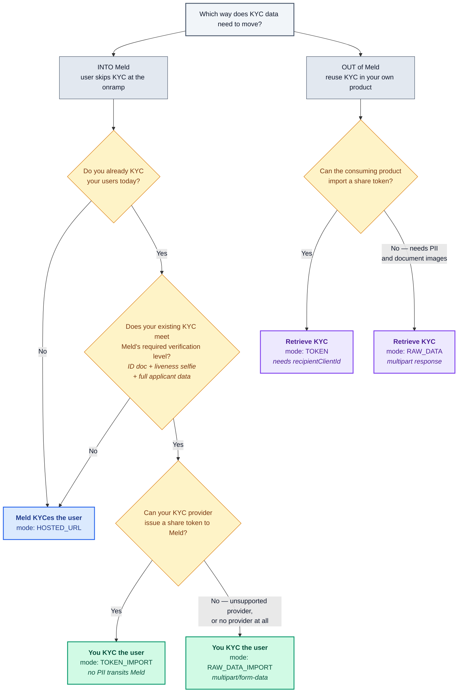

This section is for developers who want to KYC their users once and reuse that verification across multiple onramps. Meld's Unified KYC lets a user complete KYC a single time and then transact through any supported onramp without re-verifying — improving conversion and reducing friction.

There are 3 flows within Unified KYC:

1. [**Meld KYCes the user:**](/docs/stablecoins/unified-kyc/meld-kyces-the-user) You call Meld's API to get back a KYC link and launch it from your UI; Meld handles the rest. **This is the best flow from a user experience standpoint**, as Meld will ensure it collects all KYC data required by the downstream onramps.
2. [**You KYC the user:**](/docs/stablecoins/unified-kyc/you-kyc-the-user) You integrate a KYC provider yourself, run the user through their KYC process, track status, then pass the KYC token or the raw KYC data to Meld. Since this flow is more work for you, and you would need to ensure that you collect all of the KYC data that the onramps require, this flow is only recommended if you're already KYCing users with a KYC provider.
3. [**Retrieve KYC Data:**](/docs/stablecoins/unified-kyc/retrieve-kyc) If you have a use case where you need the KYC data of your existing users, such as to KYC them for a separate product you are offering, you can fetch a KYC token or the raw KYC data of the user from Meld.

Unified KYC verifies a user at a level, and each onramp has a minimum level. Name the onramps the user may use, and Meld picks the level and steps the user up when an order needs more. See [KYC levels](/docs/stablecoins/unified-kyc/kyc-levels).

## Which flow should I use?



## Share KYC with providers

Approving a customer does not on its own reach every onramp. Providers that take their KYC as a share from Meld, such as Banxa, receive it only if you name them on `kyc/initiate`. With `Meld-Version: 2026-11-01`, name every provider the customer may use in `targetServiceProviders`. This works the same whichever flow starts the KYC: `HOSTED_URL`, `TOKEN_IMPORT` or `RAW_DATA_IMPORT`.

```json
{
  "targetServiceProviders": ["BANXA", "UPHOLD"]
}
```

- **Name every provider you will order with** whose KYC comes from a share. Meld shares with each one once the customer is approved at that provider's [level](/docs/stablecoins/unified-kyc/kyc-levels) and the provider has what it needs before the share. A Level 1 approval waits until the customer steps up to Level 2. A provider left out never receives the customer's KYC, and its orders are refused with `403 KYC_NOT_COMPLETED`. In the [checklist](/docs/stablecoins/headless-integration/shared-flows/eligibility#the-checklist), `PROVIDER_KYC_SHARE` is the share and `PROVIDER_REVIEW` is the provider's verdict on it.
- **To add a provider later**, call the same `POST` naming it. For a customer already approved at its level, Meld shares straight away and answers `200` with `status: APPROVED` and `url` `null`. A `PATCH` with the same list, plus `serviceProvider` and `mode`, does the same without ever changing the level.
- **Name only the providers the customer should be ready for.** The highest level among them is the one the customer verifies at. See [One provider list](/docs/stablecoins/unified-kyc/kyc-levels#one-provider-list-meld-version-2026-11-01).

### What a provider needs before the share

Some providers need more than an approval before Meld can share with them:

| Provider | Before the share |
| --- | --- |
| Uphold | An email, an address with a country, and Uphold's onboarding terms, accepted by the customer from their IP address |
| Due Network | A first and last name, an email, and an address with a country |
| Banxa, Noah, Coinme, Onmeta | Nothing more |

- **A provider you name never makes the call fail on these.** Meld adds it to the share providers and waits. It shares once the last one is in: when Unified KYC approves the customer, when the customer accepts the terms, when you `PATCH` the customer's email or name, or when you add or update their address.
- **The response says what is missing.** `sharePrerequisites` has one entry per named provider still waiting, for example `{"serviceProvider": "UPHOLD", "missing": [{"type": "TERMS", "purpose": "ONBOARDING"}, {"type": "EMAIL"}]}`. `type` is `TERMS`, `EMAIL`, `NAME` or `ADDRESS`, and can gain values.
- **Eligibility lists them** as steps in the [checklist](/docs/stablecoins/headless-integration/shared-flows/eligibility#the-checklist), before `MELD_KYC`: an `AGREEMENT` for each terms document and a `CUSTOMER_DETAILS` step for each missing detail. `PROVIDER_KYC_SHARE` depends on them, and `MELD_KYC` never does, so the customer can start Unified KYC while you collect them.
- **A forwarded token can't wait.** If your account is set up to pass a `TOKEN_IMPORT` token straight to the providers instead of importing it into Meld, Meld never stores the token, so it checks every named provider first. If any lacks one of these, the call fails with `422` and `code: KYC_SHARE_PREREQUISITES_MISSING`, and nothing is forwarded. `errors` lists each one as `PROVIDER:TYPE`, for example `["DUENETWORK:NAME", "UPHOLD:TERMS", "UPHOLD:EMAIL"]`. Supply what is listed and call again. Your Meld representative can tell you which way your account handles tokens.

### Before Meld-Version 2026-11-01

Older versions refuse `targetServiceProviders`, even empty, with `400` and `code: KYC_TARGETS_NEED_MELD_VERSION`. They name providers in two other fields, which `2026-11-01` still accepts as part of the same list:

- **`kycShareProviders`**, the providers to share with, is checked up front before 2026-11-01. A provider that lacks what it needs before the share fails the call with `422 KYC_SHARE_PREREQUISITES_MISSING`, with `errors` as above, and KYC doesn't start.
- **`targetServiceProvider`** names one provider, on `POST` only. Meld picks the level from it, adds it to the share providers, and waits for what it needs instead of failing. Before 2026-11-01, `PATCH` ignores it.
- **A second `POST` without `targetServiceProvider` or `order`**, or one naming a provider the customer was already shared with, returns `409`. Use `PATCH` with the same body, `serviceProvider` and `mode` included, to add a provider or get a fresh `url`. With `targetServiceProvider` or `order`, the `POST` answers by the state of the customer's Unified KYC, as in [Step up](/docs/stablecoins/unified-kyc/kyc-levels#step-up).
