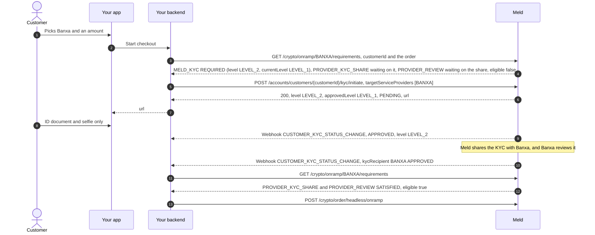

Unified KYC verifies a customer at a level. Each provider has a minimum level, and a customer reaches a provider once their Unified KYC is approved at that level or higher. You never choose the level: name the providers the customer may use, and Meld picks it.

<Note>
  Level 1 is off until Meld turns it on for your account. Until then, every customer is verified at Level 2, as before levels existed, and Stripe and Coinbase work as [Wallets](/docs/stablecoins/headless-integration/wallets#providers) describes for accounts without Level 1. Ask your Meld account manager to turn it on once your integration reads the level fields on this page. A client that ignores them would take a Level 1 approval for a Level 2 one.
</Note>

## The levels

| Level | What the customer does on the Sumsub page | Available to |
| --- | --- | --- |
| `LEVEL_1` | Confirms their name, date of birth, US residence address and other personal details, and types their SSN. Meld fills in what the Meld customer already holds, so the SSN is often all they type. No ID document and no selfie | Customers with a US `RESIDENCE` address, on an account with Level 1 on |
| `LEVEL_2` | The same personal details, with their SSN or other tax ID, plus an ID document and a selfie | Every customer. Every approval made before levels counts as Level 2 |
| `LEVEL_3` | Reserved for a later level that adds proof of funds or address | No provider needs it yet |

- A customer approved at a level also meets every lower one.
- Levels can be added. Treat a level you don't recognise as not approved.

---

## Each provider's minimum level

| Provider | Minimum level | When the customer needs it |
| --- | --- | --- |
| Coinbase | `LEVEL_1` | Only at Coinbase's lifetime cap, to raise it. Guest orders need no Unified KYC. See [Coinbase guest checkout and step-up KYC](/docs/stablecoins/headless-integration/wallets#coinbase-guest-checkout-and-step-up-kyc) |
| Stripe | `LEVEL_1` | With Level 1 on: before an order Stripe hasn't already verified the customer for. Without it, Stripe needs no Unified KYC. See [Wallets → Stripe](/docs/stablecoins/headless-integration/wallets#stripe) |
| Brale, T-0, Yellow Card | None | Never. They verify the business or institution themselves |
| Every other provider | `LEVEL_2` | Before the share or the order, as [Which providers need Unified KYC](/docs/stablecoins/headless-integration/shared-flows/eligibility#which-providers-need-unified-kyc) lists |

Read a provider's minimum from `kycLevel` on [`GET /network-partner/supported/partners`](/api-reference/network-partners/supported/list-supported-partners) rather than hardcoding this table: `NONE`, `LEVEL_1`, `LEVEL_2` or `LEVEL_3`. A provider can move to a lower level without a change on your side.

For a given customer, the [quote](/docs/stablecoins/headless-integration/shared-flows/quotes#customer-readiness-on-each-row) answers it per row: each headless purchase row's `customerKyc` carries the provider's `requiredLevel`, the customer's `approvedLevel`, and whether the customer reaches it.

Meld shares a customer's KYC with a provider only once their approval reaches that provider's level. A Level 1 approval isn't shared with Banxa, Noah or Due Network, and doesn't count for Mercuryo, until the customer steps up to Level 2. Some providers also need details or terms before the share: see [What a provider needs before the share](/docs/stablecoins/unified-kyc#what-a-provider-needs-before-the-share).

---

## One provider list (Meld-Version 2026-11-01)

Start Unified KYC with [`POST /accounts/customers/{customerId}/kyc/initiate`](/api-reference/customer/customers/accounts-customers-kyc-initiate) and `Meld-Version: 2026-11-01`, naming every provider the customer may use:

```json
{
  "targetServiceProviders": ["BANXA", "UPHOLD"]
}
```

`serviceProvider` and `mode` default to `SUMSUB` and `HOSTED_URL` on a `POST`, so you can leave them out.

| You name | Meld verifies at |
| --- | --- |
| Providers with a minimum level | The highest minimum among them. A provider whose level Meld doesn't know counts as Level 2 |
| No provider, or only providers whose minimum is `NONE` | Your account's entry level: the lowest minimum among the providers enabled on your account, or Level 2 if none of them uses Level 1 |

Two rules apply on top:

- **Level 1 is US-only.** A customer without a `RESIDENCE` address in the US is verified at Level 2. Add the address with [`POST /accounts/customers/{customerId}/addresses`](/api-reference/customer/customers/accounts-customers-addresses-create) before you start KYC.
- **Without Level 1 on your account,** the level is always Level 2.

Every provider in the list that takes a KYC share waits for two things: an approval at its level, and what it needs before the share, such as Uphold's terms. Meld shares with each one as soon as both are in, and what a provider needs never makes the call fail. A provider that takes no share, such as Coinbase or Stripe, only counts toward the level. See [What a provider needs before the share](/docs/stablecoins/unified-kyc#what-a-provider-needs-before-the-share).

**Name only the providers the customer should be ready for.** One Level 2 provider in the list verifies a Level 1 customer at Level 2, with an ID document and a selfie. So a customer who onboards before choosing a provider, with no list, starts at the lowest level your providers use, and steps up only when they head to a provider that needs more. When Meld steps a customer up, it first shares with every named provider their current approval already reaches.

| Request field | Required | Description |
| --- | --- | --- |
| `targetServiceProviders` | no | The providers the customer may use, for example `BANXA` or `COINBASEPAY`. Up to 25. Repeats count once. An unknown provider is a `400` |
| `order` | no | The order the customer is about to place: `paymentMethodType`, `sourceCurrencyCode`, `sourceAmount`, `destinationCurrencyCode` and `countryCode`, and optionally `destinationNetworkCode` and `subdivision`. Meld picks the level from the providers today, so `order` doesn't change it |
| `serviceProvider` | no on `POST` | The KYC provider, `SUMSUB`. Still required on `PATCH` |
| `mode` | no on `POST` | `HOSTED_URL` by default. Still required on `PATCH` |

The response:

```json
{
  "customerId": "W9kL817BBS7bNEwxAZaX4z",
  "serviceProvider": "SUMSUB",
  "status": "PENDING",
  "url": "https://...",
  "level": "LEVEL_2",
  "approvedLevel": "LEVEL_1",
  "sharePrerequisites": [
    {
      "serviceProvider": "UPHOLD",
      "missing": [{ "type": "TERMS", "purpose": "ONBOARDING" }, { "type": "EMAIL" }]
    }
  ],
  "expiresAt": "2026-11-04T15:30:00Z"
}
```

| Field | Meaning |
| --- | --- |
| `url` | The Sumsub page to open, or `null` when there is nothing to open |
| `level` | The level the `url` verifies, or the level the customer is approved at when there's no `url` |
| `approvedLevel` | The highest level the customer is approved at. Absent when nothing is approved |
| `sharePrerequisites` | `2026-11-01` only. One entry for each named provider that takes a share, hasn't received it, and still needs something before it. `missing[].type` is `TERMS`, `EMAIL`, `NAME` or `ADDRESS`, and can gain values. A `TERMS` entry names its `purpose`, and [eligibility](/docs/stablecoins/headless-integration/shared-flows/eligibility#the-checklist) lists the documents. Absent when nothing is missing |
| `expiresAt` | When `url` stops opening, in UTC. Present only with a `url`, on every version. Call the same `POST` again for a fresh one |

Open the `url` in your app, as in [Meld KYCes the user](/docs/stablecoins/unified-kyc/meld-kyces-the-user#step-3-have-meld-kyc-the-user).

`PATCH /accounts/customers/{customerId}/kyc/initiate` takes the same list, with `serviceProvider` and `mode`. It adds the providers, and Meld shares with each one once it is ready, straight away for a customer already approved at its level. A `PATCH` never changes the level. `serviceProviderDetails` on a `PATCH` goes to the providers it names, and is a `400` without any.

### Other spellings and older versions

On `2026-11-01`, `targetServiceProvider` and `kycShareProviders` still work. Meld adds them to the same list, and they behave exactly like `targetServiceProviders`, on `POST`, multipart `POST` and `PATCH`. Use `targetServiceProviders` in new code.

Before `2026-11-01`, `targetServiceProviders` is refused with `400` and `code: KYC_TARGETS_NEED_MELD_VERSION`, even when it is empty, and nothing is started. Older versions take `targetServiceProvider` and `kycShareProviders` instead, as [Before Meld-Version 2026-11-01](/docs/stablecoins/unified-kyc#before-meld-version-2026-11-01) describes. An API key without a `Meld-Version` header gets its default version, which is older, so send the header.

---

## Step up

When an order needs a higher level than the customer's approval, call the same `POST` with that provider in `targetServiceProviders`. Meld moves the customer's existing verification up to the new level. It never starts a second one, and the customer adds only what the new level asks for: from Level 1 to Level 2, an ID document and a selfie.

On `2026-11-01`, every `POST` answers by the state of the customer's Unified KYC, so you can call it again at any time:

| The customer's Unified KYC | Response |
| --- | --- |
| None yet | `200`, `PENDING`, with a `url` at the picked level |
| Approved at the picked level or higher | `200`, `APPROVED`, with `url` `null`. Nothing to open. Meld shares with each named provider that is ready |
| Started at the picked level or higher, not approved | `200`, with a fresh `url` and the current `status` |
| Below the picked level, not in review | `200`, `PENDING`, with a `url` that asks only for what the new level adds |
| Below the picked level, in review | `409`, `code: KYC_REVIEW_IN_PROGRESS`. Wait for the `CUSTOMER_KYC_STATUS_CHANGE` webhook, then call again |
| Rejected as final | `422`, `code: KYC_BLOCKED`. Don't retry. No provider that needs Unified KYC will take this customer |

A step-up refused because the customer is in review still shares with the named providers their current approval reaches.

While the higher level is in review, `approvedLevel` stays at the lower level, so providers that need only that level keep working. If the higher level is rejected and the customer can retry, `approvedLevel` still stays. A final rejection clears it.

| HTTP | `code` | When |
| --- | --- | --- |
| `400` | `BAD_REQUEST` | A malformed body, such as a `null` or unknown provider, more than 25 providers, or part of an `order`. `errors` names the field |
| `400` | `KYC_TARGETS_NEED_MELD_VERSION` | `targetServiceProviders` on a version before `2026-11-01` |
| `404` | `NOT_FOUND` | The customer doesn't exist |
| `409` | `KYC_REVIEW_IN_PROGRESS` | A level change while the current verification is in review |
| `422` | `KYC_BLOCKED` | A final rejection |
| `422` | `KYC_SHARE_PREREQUISITES_MISSING` | Only a `TOKEN_IMPORT` that Meld forwards to the providers: see [What a provider needs before the share](/docs/stablecoins/unified-kyc#what-a-provider-needs-before-the-share) |

---

## Where you read the level

| Where | Fields |
| --- | --- |
| [`GET /crypto/onramp/{serviceProvider}/requirements`](/docs/stablecoins/headless-integration/shared-flows/eligibility#the-checklist) | The `MELD_KYC` item in `requirements` carries `level`, the level that provider needs, and `currentLevel`, the level the customer is approved at |
| [`POST /accounts/customers/{customerId}/kyc/initiate`](/api-reference/customer/customers/accounts-customers-kyc-initiate) | `level` and `approvedLevel`, as above |
| [`GET /accounts/customers`](/api-reference/customer/customers/accounts-customers-search) | `level` and `approvedLevel` in `serviceProviderCustomers[].kyc`, on the `SUMSUB` entry only |
| The [`CUSTOMER_KYC_STATUS_CHANGE`](/docs/stablecoins/for-all-products/webhook-events#customer_kyc_status_change) webhook | `level`, `approvedLevel` and, for a provider's verdict on a share, `kycRecipient` |

`status: APPROVED` on its own no longer means a customer can order from every provider. Compare `approvedLevel` with the provider's level, or let eligibility do it for you.

---

## The journey

The loop is the same for every provider. Eligibility tells you what's outstanding, `kyc/initiate` starts or steps up Unified KYC, and the webhook tells you when to check again. This customer is approved at Level 1 and now orders from Banxa, which needs Level 2 and a share:



1. **Check eligibility** with the customer and the whole order: [Check the requirements](/docs/stablecoins/headless-integration/shared-flows/eligibility#check-the-requirements).
2. **Work through `requirements`**, as [The checklist](/docs/stablecoins/headless-integration/shared-flows/eligibility#the-checklist) describes: do every step whose `dependsOn` is clear and whose `action` is a `CALL`, `OPEN_URL` or `SDK_STEP`, and wait on the rest. A `MELD_KYC` item that is `REQUIRED` carries the `kyc/initiate` call, with `targetServiceProviders` already set when you read the checklist with `Meld-Version: 2026-11-01`. Send each call with the same `Meld-Version` you read the checklist with. The `MELD_KYC` item never waits on what a provider needs before the share.
3. **Wait for the webhooks**: one when the customer's Unified KYC is approved, and, for a provider that takes a share, one with `kycRecipient` when the provider gives its verdict. Check eligibility again after each.
4. **Create the order** once `eligible` is `true`.

For the provider-specific steps on top, see [Coinbase guest checkout and step-up KYC](/docs/stablecoins/headless-integration/wallets#coinbase-guest-checkout-and-step-up-kyc) and [Wallets → Stripe](/docs/stablecoins/headless-integration/wallets#stripe).

---

## Importing KYC you ran yourself

A `RAW_DATA_IMPORT`, as in [You KYC the user](/docs/stablecoins/unified-kyc/you-kyc-the-user), also takes `targetServiceProviders` and `order` in its `data` part, and Meld picks the level the same way:

- At Level 1, `documents` is optional, and the applicant's address must be in the US.
- Documents, or an address outside the US, make it Level 2.
- A Level 2 import without documents is refused with `400`, before anything reaches Sumsub.
- An import onto a customer verified at a lower level moves that verification up.

Before `2026-11-01`, an import without `targetServiceProvider` or `order` works as before and needs documents.
