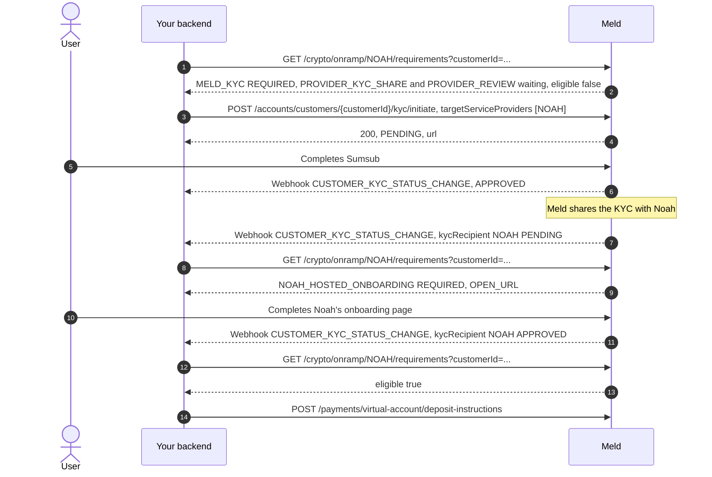

> End-to-end guide for integrating Meld’s standing virtual-account onramp (fiat → crypto) over the Payment and Account APIs.

A provider provisions reusable bank deposit details for the user. When the user sends fiat to that account, the provider converts it and sends crypto to the destination wallet you registered. You present your own UI — there is no Meld-hosted widget.

Fetch deposit instructions **once** per customer \+ provider \+ payment method \+ currency pair \+ destination wallet. The user reuses the same account for later deposits.

> **API compatibility:** New fields may appear in responses without a version bump. Use flexible JSON parsing and do not reject unknown properties. Breaking changes ship under a dated `Meld-Version`.

---

## Before you begin

- You have a Meld API key with payment access (sandbox first, production for go-live)

<Note>
  For the sandbox testing guide, please refer to [Virtual Account Flow Testing Credentials](/docs/stablecoins/sandbox-guide/virtual-account-flow-testing-credentials)
</Note>

- You have a webhook endpoint configured in **Developer → Webhooks** in the dashboard
- At least one headless-capable onramp provider is enabled on your account (for example Noah, Due Network, or Brale)
- Your account has headless onramps enabled (`account_preference.crypto.headlessOnrampsEnabled`). Reach out to Meld support to confirm this is enabled.
- If you are using Meld to KYC, then your Meld account must have Sumsub configured. Reach out to Meld for help enabling this if needed.

---

## Flow overview

```text
Customer → Webhooks → Requirements → KYC → Requirements until eligible → Fetch VA details (once) → [Quote] → User sends fiat → Webhooks / GET transaction
```

### One time per user

1. Create a customer (and address when required).
2. Configure webhooks.
3. Read the requirements of each provider you will use.
4. Complete what they list, KYC included, until `eligible` is `true`.
5. **Fetch virtual account details** for customer \+ provider \+ payment method \+ currency pair \+ destination wallet.

### Every deposit

6. (Optional) Get a quote for the amount the user wants to send.
7. User sends fiat to the **same** stored VA details.
8. Track via webhooks / Transactions API.

---

## Provider-specific requirements

Most of this guide applies to every provider. Some providers need something extra or work differently. Check the rows for the providers enabled on your account.

| Provider | Code | What is different |
| --- | --- | --- |
| Noah | `NOAH` | After the share, Noah may ask for its own onboarding. The requirements list it as `NOAH_HOSTED_ONBOARDING` (see step 4c). |
| Due Network | `DUENETWORK` | Before the KYC share, the customer needs a first and last name, an email and a residential address with a country. The requirements list each missing one as a `CUSTOMER_DETAILS` step, and Meld shares with Due once they are in. Due uses the address `country` when it creates the provider customer. After the share, Due may ask for its own onboarding (`DUENETWORK_HOSTED_ONBOARDING`), and has its own terms of service, separate from KYC (`DUENETWORK_HOSTED_TERMS`). See step 4c. |
| Brale | `BRALE` | Business customers only. Brale runs KYB itself, so it does not use the Sumsub share, and its requirements list no KYC steps. |

---

## 1. Create a customer

**Endpoint:** `POST /accounts/customers`

**Once per end user.** Reuse the same Meld `customerId` for KYC, quotes, and deposit instructions.

### Required fields

| Field | Required | Notes |
| --- | --- | --- |
| `externalId` | recommended | Your internal user id — useful for correlation |
| `name.firstName` / `name.lastName` | yes for KYC | Required for Sumsub / provider KYC |
| `email` | yes for KYC | Required for Sumsub / provider KYC |
| `dateOfBirth` | yes for KYC | Required for Sumsub / provider KYC |
| `type` | yes | e.g. `INDIVIDUAL` |

```json
{
  "externalId": "your-internal-user-id-123",
  "name": {
    "firstName": "John",
    "lastName": "Doe"
  },
  "email": "john@example.com",
  "dateOfBirth": "1990-03-15",
  "type": "INDIVIDUAL"
}
```

Response:

```json
{
  "id": "WmYYgvN8ukpV62N3m4u3ee",
  "accountId": "W2aRZnYGPwhBWB94iFsZus",
  "externalId": "your-internal-user-id-123",
  "status": "ACTIVE",
  "type": "INDIVIDUAL",
  "serviceProviderCustomers": [],
  "addresses": []
}
```

Save the returned `id`. You may also use `externalCustomerId` on some endpoints when supported.

### Add a customer address (when your provider requires it)

Some providers need a residential address before KYC (see [Provider-specific requirements](#provider-specific-requirements)). Add it before you start KYC.

**Endpoint:** `POST /accounts/customers/{customerId}/addresses`

```json
{
  "type": "RESIDENCE",
  "address": {
    "firstName": "John",
    "lastName": "Doe",
    "lineOne": "123 Market St",
    "lineTwo": "Apt 4",
    "city": "San Francisco",
    "region": "CA",
    "countryCode": "US",
    "postalCode": "94105"
  }
}
```

Response:

```json
{
  "id": "addr_01HXYZEXAMPLE000000001",
  "customerId": "WmYYgvN8ukpV62N3m4u3ee",
  "type": "RESIDENCE",
  "status": "ACTIVE",
  "addressDetails": {
    "lineOne": "123 Market St",
    "lineTwo": "Apt 4",
    "city": "San Francisco",
    "region": "CA",
    "country": "US",
    "postalCode": "94105"
  }
}
```

---

## 2. Configure webhooks

Set this up **before KYC** so you receive `CUSTOMER_KYC_STATUS_CHANGE` as well as transaction events.

In the Meld dashboard (**Developer → Webhooks**), subscribe at minimum to:

- `CUSTOMER_KYC_STATUS_CHANGE`
- `TRANSACTION_CRYPTO_PENDING`
- `TRANSACTION_CRYPTO_TRANSFERRING`
- `TRANSACTION_CRYPTO_COMPLETE`
- `TRANSACTION_CRYPTO_FAILED`

Verify signatures per Webhook authentication docs.

---

## 3. Check the requirements

**Endpoint:** `GET /crypto/onramp/{serviceProvider}/requirements?customerId={customerId}`

**Header:** `Meld-Version: 2026-11-01`

Read each provider's requirements before you start KYC, one call per provider. This is the [eligibility](/docs/stablecoins/headless-integration/shared-flows/eligibility#check-the-requirements) endpoint headless orders use. Send `customerId` only: deposit instructions have no amount, so there is no order to check. The response lists every step between this customer and the provider, with the call that clears each one.

<Tip>
  In an app or a web page, [`Meld.ensureReady`](/docs/stablecoins/headless-integration/sdks/customer-requirements#virtual-accounts-and-offramps) can run these steps for you: create a requirements session for the customer and your providers, without an order, and fetch the deposit instructions once it ends `READY`.
</Tip>

A new customer heading to Noah:

```json
{
  "serviceProvider": "NOAH",
  "eligible": false,
  "requirements": [
    {
      "type": "MELD_KYC", "code": "MELD_KYC_APPROVED", "status": "REQUIRED", "timing": "PRE_ORDER",
      "level": "LEVEL_2",
      "action": {
        "type": "CALL", "method": "POST",
        "path": "/accounts/customers/WmYYgvN8ukpV62N3m4u3ee/kyc/initiate",
        "body": { "targetServiceProviders": ["NOAH"] }
      }
    },
    {
      "type": "PROVIDER_KYC_SHARE", "code": "PROVIDER_KYC_SHARE", "status": "REQUIRED", "timing": "PRE_ORDER",
      "dependsOn": ["MELD_KYC_APPROVED"],
      "action": { "type": "WAIT", "event": "CUSTOMER_KYC_STATUS_CHANGE" }
    },
    {
      "type": "PROVIDER_REVIEW", "code": "PROVIDER_KYC_APPROVED", "status": "REQUIRED", "timing": "PRE_ORDER",
      "dependsOn": ["PROVIDER_KYC_SHARE"],
      "action": { "type": "WAIT", "event": "CUSTOMER_KYC_STATUS_CHANGE" }
    }
  ]
}
```

For Due Network, the same customer without a name, an email or an address also has a `CUSTOMER_DETAILS` step for each, before `MELD_KYC`:

| `type` | `code` | `status` | `action` |
| --- | --- | --- | --- |
| `CUSTOMER_DETAILS` | `CUSTOMER_NAME` | `REQUIRED` | `CALL PATCH /accounts/customers/{customerId}`, with `name.firstName` and `name.lastName` |
| `CUSTOMER_DETAILS` | `CUSTOMER_EMAIL` | `REQUIRED` | `CALL PATCH /accounts/customers/{customerId}`, with `email` |
| `CUSTOMER_DETAILS` | `CUSTOMER_ADDRESS` | `REQUIRED` | `CALL POST /accounts/customers/{customerId}/addresses`, with a `RESIDENCE` address |
| `MELD_KYC` | `MELD_KYC_APPROVED` | `REQUIRED` | `CALL POST /accounts/customers/{customerId}/kyc/initiate`, `targetServiceProviders: [DUENETWORK]` |

Due's `PROVIDER_KYC_SHARE` then depends on those details as well as on `MELD_KYC_APPROVED`. `MELD_KYC` never depends on them, so the customer can start KYC while you collect them.

Work through the list as [The checklist](/docs/stablecoins/headless-integration/shared-flows/eligibility#the-checklist) describes: do each step whose `dependsOn` steps are `SATISFIED` and whose `action` is a `CALL` or `OPEN_URL`, wait on the rest, and read the requirements again after each step and each webhook. The provider is ready once `eligible` is `true`.

---

## 4. KYC

Start Unified KYC once per customer, naming every provider you plan to use. Take the call from the `MELD_KYC` step's `action`, and add the providers your other requirements name.

**Endpoint:** `POST /accounts/customers/{customerId}/kyc/initiate`

**Header:** `Meld-Version: 2026-11-01`

Choose one Sumsub initiation mode:

| Mode | When to use | What you send | What the user does |
| --- | --- | --- | --- |
| `HOSTED_URL` | User has **not** completed Sumsub yet | `targetServiceProviders`. `serviceProvider: SUMSUB` and `mode: HOSTED_URL` are the defaults | Open the returned `url` and complete Sumsub |
| `TOKEN_IMPORT` | User already has a Sumsub applicant in your Sumsub account | `serviceProvider: SUMSUB`, `mode: TOKEN_IMPORT`, `targetServiceProviders`, and `serviceProviderDetails.kycToken` / `applicantId` | Usually nothing for Sumsub — Meld imports the existing applicant |

For virtual-account onramps, `NOAH` and `DUENETWORK` take a shared Sumsub KYC. Meld shares with each one once Sumsub approves the customer and the provider has what it needs before the share, such as Due's name, email and address. A provider that still lacks one never fails the call: the response lists it in `sharePrerequisites`, and Meld shares once you add it. See [What a provider needs before the share](/docs/stablecoins/unified-kyc#what-a-provider-needs-before-the-share).

### 4a. `HOSTED_URL` — Meld returns a Sumsub link

```json
{
  "targetServiceProviders": ["NOAH", "DUENETWORK"]
}
```

Response:

```json
{
  "customerId": "WmYYgvN8ukpV62N3m4u3ee",
  "serviceProvider": "SUMSUB",
  "status": "PENDING",
  "url": "https://kyc-provider.example.com/verify/abc123",
  "level": "LEVEL_2",
  "expiresAt": "2026-11-04T15:30:00Z"
}
```

Direct the user to `url` before `expiresAt`. Calling the same `POST` again gives a fresh one. Listen for `CUSTOMER_KYC_STATUS_CHANGE`.

### 4b. `TOKEN_IMPORT` — import an existing Sumsub applicant

```json
{
  "serviceProvider": "SUMSUB",
  "mode": "TOKEN_IMPORT",
  "targetServiceProviders": ["NOAH", "DUENETWORK"],
  "serviceProviderDetails": {
    "kycToken": "_act-sbx-jwt-…",
    "applicantId": "sumsub-applicant-id"
  }
}
```

There is typically no Sumsub `url` to open — Meld attaches the existing applicant and shares with each named provider. Listen for `CUSTOMER_KYC_STATUS_CHANGE` the same way.

If your account is set up to forward the token straight to the providers instead of importing it, Meld can't wait for what a provider needs before the share. A provider that lacks it fails the call with `422 KYC_SHARE_PREREQUISITES_MISSING`, and nothing is forwarded.

### 4c. After Sumsub: the provider's own steps

After each `CUSTOMER_KYC_STATUS_CHANGE` webhook, read the requirements again. Once Meld has shared the KYC, a provider may still need its own step, which the requirements list with an `OPEN_URL` action. Noah, after the share, with its hosted onboarding open:

```json
{
  "serviceProvider": "NOAH",
  "eligible": false,
  "requirements": [
    { "type": "MELD_KYC", "code": "MELD_KYC_APPROVED", "status": "SATISFIED", "timing": "PRE_ORDER", "level": "LEVEL_2", "currentLevel": "LEVEL_2" },
    { "type": "PROVIDER_KYC_SHARE", "code": "PROVIDER_KYC_SHARE", "status": "SATISFIED", "timing": "PRE_ORDER" },
    {
      "type": "EXTERNAL_KYC", "code": "NOAH_HOSTED_ONBOARDING", "status": "REQUIRED", "timing": "PRE_ORDER",
      "action": {
        "type": "OPEN_URL",
        "url": "https://onboarding.noah.example/hosted?session=...",
        "expiresAt": "2026-11-04T15:45:00Z",
        "refresh": {
          "method": "POST",
          "path": "/accounts/customers/WmYYgvN8ukpV62N3m4u3ee/kyc/initiate",
          "body": { "targetServiceProviders": ["NOAH"] }
        }
      }
    },
    {
      "type": "PROVIDER_REVIEW", "code": "PROVIDER_KYC_APPROVED", "status": "PENDING", "timing": "PRE_ORDER",
      "dependsOn": ["NOAH_HOSTED_ONBOARDING"],
      "action": { "type": "WAIT", "event": "CUSTOMER_KYC_STATUS_CHANGE" }
    }
  ]
}
```

| Step | What to do |
| --- | --- |
| `NOAH_HOSTED_ONBOARDING`, `DUENETWORK_HOSTED_ONBOARDING` | Open `action.url` for the user. When `url` is absent, `expiresAt` is less than 60 seconds away, or the page fails to load, call `action.refresh`, then read the requirements again for the new `url`. Noah's hosted session lasts an hour, by Noah's own documentation |
| `DUENETWORK_HOSTED_TERMS` | Due's own terms of service. Open `action.url`. After the user closes the page, call `action.refresh` and read the requirements again: Due sends no event for its terms, and the step turns `SATISFIED` once Meld reads them accepted |
| A `WAIT` step | Wait for the `CUSTOMER_KYC_STATUS_CHANGE` webhook it names, then read the requirements again |

Never log or store a hosted URL. Meld includes it only for an API key that can create orders.

### 4d. Ready

The provider is ready once its requirements answer `eligible: true`. Fetch the deposit instructions then.

## 5. Get a quote (optional)

**Endpoint:** `POST /payments/crypto/quote?integrationMode=HEADLESS`

**Header:** `Meld-Version: 2026-05-01`

Note that Brale does not support quotes. All Brale transactions are 1:1 (USD to USD backed stablecoin).

`customerId` is optional. Pass it when available so ramp intelligence / previously-used scoring can use it.

Use quotes to show rates, fees, available providers / methods, and each provider’s `kycMode`.

```json
{
  "countryCode": "US",
  "sourceAmount": 100,
  "sourceCurrencyCode": "USD",
  "destinationCurrencyCode": "USDC",
  "paymentMethodType": "ACH",
  "customerId": "WmYYgvN8ukpV62N3m4u3ee",
  "walletAddress": "0x51FB80013111111111111112121111111"
}
```

Response:

```json
{
  "quotes": [
    {
      "transactionType": "CRYPTO_PURCHASE",
      "sourceAmount": 100.00,
      "sourceAmountWithoutFees": 99.10,
      "fiatAmountWithoutFees": 99.10,
      "destinationAmountWithoutFees": null,
      "sourceCurrencyCode": "USD",
      "countryCode": "US",
      "totalFee": 0.90,
      "networkFee": 0.00,
      "partnerFee": 0.00,
      "transactionFee": 0.90,
      "destinationAmount": 99.10,
      "destinationCurrencyCode": "USDC",
      "exchangeRate": 1.0,
      "paymentMethodType": "ACH",
      "serviceProvider": "NOAH",
      "rampIntelligence": {
        "rampScore": 80.71,
        "lowKyc": null,
        "previouslyUsed": null
      },
      "integrationMode": "HEADLESS",
      "kycMode": "ASYNC"
    }
  ]
}
```

> Some providers (for example Brale) may not surface commercial quotes the same way; confirm available providers in Network Partner / quote responses for your account.

---

## 6. Fetch virtual account details

**Endpoint:** `POST /payments/virtual-account/deposit-instructions`

**Call this once** for that customer \+ provider \+ payment method \+ currency pair \+ destination wallet. Store the returned bank details. Do **not** call again for each deposit unless that combination changes.

**Idempotency (recommended):** `X-Idempotency-Key: <uuid>`

- Successful create / return → HTTP **201**
- Same key after success → cached body, HTTP **200**

### Request (ACH example)

```json
{
  "customerId": "WmYYgvN8ukpV62N3m4u3ee",
  "serviceProvider": "NOAH",
  "paymentMethodType": "ACH",
  "sourceCurrencyCode": "USD",
  "destinationCurrencyCode": "USDC",
  "destinationWalletAddress": "0x51FB80013111111111111112121111111",
  "countryCode": "US"
}
```

| Field | Required | Notes |
| --- | --- | --- |
| `customerId` | yes | Meld customer id. This endpoint does **not** accept `externalCustomerId` — resolve yours first via `GET /accounts/customers?externalCustomerId=...` |
| `serviceProvider` | yes | From quote / capability discovery |
| `paymentMethodType` | yes | `ACH`, `SEPA`, `PIX`, or `MOBILE_MONEY` |
| `sourceCurrencyCode` | yes | Fiat |
| `destinationCurrencyCode` | yes | Crypto |
| `destinationWalletAddress` | yes | Where crypto is delivered |
| `countryCode` | yes | The customer's country of residence (ISO 3166-1 alpha-2). Used to check the provider offers this payment method to residents of that country — not where the user is sitting, and not the country of the provider's receiving account |
| `customerPhoneNumber` | conditional | Required for `MOBILE_MONEY` |

### Response (ACH example)

```json
{
  "depositInstructionsId": "WdEPOSITabcexample000001",
  "customerId": "WmYYgvN8ukpV62N3m4u3ee",
  "serviceProvider": "NOAH",
  "paymentMethodType": "ACH",
  "sourceCurrencyCode": "USD",
  "destinationCurrencyCode": "USDC",
  "destinationWalletAddress": "0x51FB80013111111111111112121111111",
  "receivingBankInformation": {
    "accountNumber": "441829750331",
    "routingNumber": "031101279",
    "bankName": "Example Community Bank",
    "accountHolderName": "Jordan Avery Ellis"
  },
  "serviceProviderDetails": {
    "bankCode": "031101279",
    "bankName": "Example Community Bank",
    "bankAddress": {
      "city": "Austin",
      "state": "TX",
      "street": "100 Main Street",
      "country": "US",
      "postCode": "78701"
    },
    "accountNumber": "441829750331",
    "paymentMethodId": "Bank/Ach/USD/031101279/441829750331/example-payment-method-id",
    "accountHolderName": "Jordan Avery Ellis",
    "paymentMethodType": "BankAch"
  }
}
```

Display details from `receivingBankInformation` (typed fields) and any extras in `serviceProviderDetails`. The user sends fiat from their bank app. Meld and the provider do **not** collect the user’s bank login credentials.

### Response (SEPA example)

```json
{
  "depositInstructionsId": "WdEPOSITabcexample000002",
  "customerId": "WmYYgvN8ukpV62N3m4u3ee",
  "serviceProvider": "DUENETWORK",
  "paymentMethodType": "SEPA",
  "sourceCurrencyCode": "EUR",
  "destinationCurrencyCode": "USDC",
  "destinationWalletAddress": "0x51FB80013111111111111112121111111",
  "receivingBankInformation": {
    "iban": "DE89370400440532013000",
    "bic": "COBADEFFXXX",
    "bankName": "Example European Bank",
    "accountHolderName": "Jordan Avery Ellis"
  },
  "serviceProviderDetails": {
    "iban": "DE89370400440532013000",
    "bic": "COBADEFFXXX",
    "bankName": "Example European Bank",
    "accountHolderName": "Jordan Avery Ellis",
    "memo": "MELD-REF-1"
  }
}
```

For SEPA, show `iban` / `bic` (and bank / account-holder name) from `receivingBankInformation`. Some providers also return a payment reference (for example Due Network’s `memo` in `serviceProviderDetails`) — the payer **must** include this reference on the transfer so the provider can correlate funds.

### When deposit instructions are refused

| HTTP | `code` | What to do |
| --- | --- | --- |
| `403` | `KYC_NOT_COMPLETED` | The provider can't take this customer yet. Read the provider's [requirements](#3-check-the-requirements) again and complete what they list |
| `403` | `PROVIDER_TERMS_NOT_ACCEPTED` | The customer hasn't accepted the provider's own terms. `errors` names the step, such as `DUENETWORK_HOSTED_TERMS`. Read the requirements again and have the user complete it, as in step 4c |
| `403` | `WHITELABEL_NOT_ENABLED` | Not a customer step: virtual accounts aren't enabled on your account. Contact Meld |

### After you have the details

1. Store the VA details against your user.
2. On later deposits: optional quote → show the same account / routing (or IBAN) → user sends fiat.
3. Listen for transaction webhooks — no new deposit-instructions call unless destination wallet, currencies, provider, or payment method changes.

> **Testing in sandbox:** you cannot send real fiat to the account, so call the simulate endpoint to create a test deposit instead — see [Simulate a deposit](/docs/stablecoins/sandbox-guide/virtual-account-flow-testing-credentials#simulate-a-deposit).

## 7. Tracking

### Webhook events (buy)

A deposit produces this sequence. Correlate every one of them with `paymentTransactionId`.

| Event | `paymentTransactionStatus` | Meaning |
| --- | --- | --- |
| `TRANSACTION_CRYPTO_PENDING` | `PENDING` | Meld has seen the deposit and created the transaction |
| `TRANSACTION_CRYPTO_TRANSFERRING` | `SETTLING` | The provider is delivering crypto to the destination wallet |
| `TRANSACTION_CRYPTO_COMPLETE` | `SETTLED` | Crypto delivered. This is the terminal success event |
| `TRANSACTION_CRYPTO_FAILED` | `FAILED` | The deposit could not be completed |

Every event uses the same envelope and payload shape, with `eventType` and `payload.paymentTransactionStatus` moving together:

```json
{
  "eventType": "TRANSACTION_CRYPTO_PENDING",
  "eventId": "AAsuLXHXD3mS1cjNBuHHzv",
  "timestamp": "2025-02-24T16:36:41.717262Z",
  "accountId": "WQ5RyhdFzE45qjsomdzQ1u",
  "profileId": "W9ka8vLE4ufBkSg3BEciZb",
  "version": "2025-03-01",
  "payload": {
    "requestId": "f07f1accb7404aec9bd9a5d64975eed1",
    "accountId": "WQ5RyhdFzE45qjsomdzQ1u",
    "paymentTransactionId": "WePZCYJW7cdXR7SxUMp8mE",
    "customerId": "WmYYgvN8ukpV62N3m4u3ee",
    "externalCustomerId": "your-internal-user-id-123",
    "paymentTransactionStatus": "PENDING",
    "transactionType": "CRYPTO_PURCHASE"
  }
}
```

The terminal event is the same shape:

```json
{
  "eventType": "TRANSACTION_CRYPTO_COMPLETE",
  "eventId": "AAsuLXHXD3mS1cjNBuHHzv",
  "timestamp": "2025-02-24T16:41:02.118445Z",
  "accountId": "WQ5RyhdFzE45qjsomdzQ1u",
  "profileId": "W9ka8vLE4ufBkSg3BEciZb",
  "version": "2025-03-01",
  "payload": {
    "requestId": "f07f1accb7404aec9bd9a5d64975eed1",
    "accountId": "WQ5RyhdFzE45qjsomdzQ1u",
    "paymentTransactionId": "WePZCYJW7cdXR7SxUMp8mE",
    "customerId": "WmYYgvN8ukpV62N3m4u3ee",
    "externalCustomerId": "your-internal-user-id-123",
    "paymentTransactionStatus": "SETTLED",
    "transactionType": "CRYPTO_PURCHASE"
  }
}
```

<Note>
  **Virtual account payloads carry no session fields.** `sessionId` and `externalSessionId` only exist for widget transactions, which are created from a session. A virtual account deposit has none, and the payload omits empty fields entirely rather than sending them as `null` — so do not key your handler on their presence.

  The payload also does not carry the order id. To go from a webhook back to the order, take `paymentTransactionId`, call `GET /payments/transactions/{paymentTransactionId}`, and read `orderId` from the transaction.
</Note>

### Fetch the full transaction

**Endpoint:** `GET /payments/transactions/{paymentTransactionId}`

```json
{
  "transaction": {
    "id": "WePZCYJW7cdXR7SxUMp8mE",
    "accountId": "WQ5RyhdFzE45qjsomdzQ1u",
    "isPassthrough": false,
    "isImported": false,
    "customer": {
      "id": "WmYYgvN8ukpV62N3m4u3ee",
      "accountId": "WQ5RyhdFzE45qjsomdzQ1u",
      "externalId": "your-internal-user-id-123",
      "email": "john@example.com",
      "name": {
        "firstName": "John",
        "lastName": "Doe"
      }
    },
    "transactionType": "CRYPTO_PURCHASE",
    "status": "SETTLING",
    "sourceAmount": 100.00,
    "sourceCurrencyCode": "USD",
    "destinationAmount": 99.10,
    "destinationCurrencyCode": "USDC",
    "paymentMethodType": "ACH",
    "serviceProvider": "NOAH",
    "serviceTransactionId": "noah-tx-abc123",
    "serviceProviderDetails": {},
    "createdAt": "2026-07-15T18:00:00Z",
    "updatedAt": "2026-07-15T18:05:00Z",
    "countryCode": "US",
    "externalCustomerId": "your-internal-user-id-123",
    "fiatAmountInUsd": 100.00,
    "cryptoDetails": {
      "sourceWalletAddress": null,
      "destinationWalletAddress": "0x51FB80013111111111111112121111111",
      "sessionWalletAddress": "0x51FB80013111111111111112121111111",
      "networkFee": 0,
      "transactionFee": 0.90,
      "partnerFee": 0,
      "totalFee": 0.90,
      "networkFeeInUsd": 0,
      "transactionFeeInUsd": 0.90,
      "partnerFeeInUsd": 0,
      "totalFeeInUsd": 0.90,
      "blockchainTransactionId": null,
      "chainId": "1"
    }
  }
}
```

---

## Sequence Diagram



## Notes and limits

- Standing virtual accounts require `headlessOnrampsEnabled` on the account.
- The requirements are advisory. Deposit instructions are the final check, so handle their refusals too.
- Primary API: `POST /payments/virtual-account/deposit-instructions` (fetch once, reuse).
- Supported payment methods for this flow: `ACH`, `SEPA`, `PIX`, `MOBILE_MONEY`.
- Provider sandboxes do not move real money, but you can still complete a full onramp in sandbox for Noah and Due Network — see [Simulate a deposit](/docs/stablecoins/sandbox-guide/virtual-account-flow-testing-credentials#simulate-a-deposit). For other providers you may stop at instruction issuance.
