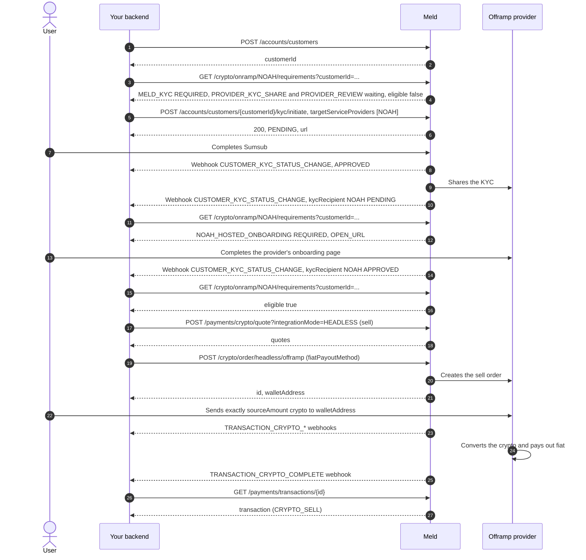

> End-to-end guide for integrating Meld’s headless offramp (crypto → fiat) over the Payment and Account APIs.

This guide walks through customer creation, KYC, quoting, order creation, and webhook tracking for the **headless offramp** flow. Callers collect a provider deposit wallet address from Meld, have the user send crypto, and the provider pays out fiat to the bank / mobile money details you supplied.

---

## Before you begin

- You have a Meld API key with payment access (sandbox first, production for go-live)

<Note>
  For the sandbox testing guide, please refer to [Virtual Account Flow Testing Credentials](/docs/stablecoins/sandbox-guide/virtual-account-flow-testing-credentials)
</Note>

- You have a webhook endpoint configured in **Developer → Webhooks** in the dashboard
- At least one headless-capable offramp provider is enabled on your account (for example Noah, Due Network, Brale, or Yellowcard)
- If you are using Meld to KYC, then your Meld account must have Sumsub configured. Reach out to Meld for help enabling this if needed.

---

## How it works

1. Create a customer in the Account API. (**one time per user**)
2. Configure webhooks (including KYC events). (**one time**)
3. Read the offramp provider's requirements and complete what they list, KYC included. (**one time per user / provider**)
4. Get a sell quote from the Payment API. (**every transaction**)
5. Create a headless offramp order with fiat payout details. (**every transaction**)
6. The end user sends crypto to the returned `walletAddress`. (**every transaction**)
7. Track the order by its status, and read it again on every webhook. (**every transaction**)

```text
Customer → Webhooks → Requirements → KYC → Quote → POST /crypto/order/headless/offramp → User sends crypto → Webhooks → GET /crypto/order/{orderId}/status
```

Step 6 stays its own step: the user (or your treasury) must send the correct crypto amount to the provider-issued address before the fiat payout can complete.

---

## 1. Create a customer

**Endpoint:** `POST /accounts/customers`

**Once per end user.** Reuse the same Meld `customerId` for all later KYC, quote, and order calls.

### Required fields

| Field | Required | Notes |
| --- | --- | --- |
| `externalId` | recommended | Your internal user id — useful for correlation |
| `name.firstName` / `name.lastName` | yes for KYC | Required for Sumsub / provider KYC |
| `email` | yes for KYC | Required for Sumsub / provider KYC |
| `dateOfBirth` | yes for KYC | Required for Sumsub / provider KYC |
| `type` | yes | e.g. `INDIVIDUAL` |
| `phone` | **no** | Optional on customer create. Format-validated only if you send it. Phone is **not** a create-customer requirement unless you later use `MOBILE_MONEY` payout (then you pass `fiatPayoutMethod.details.phoneNumber` on the **order**, not here) |

```json
{
  "externalId": "your-internal-user-id-123",
  "name": {
    "firstName": "John",
    "lastName": "Doe"
  },
  "email": "john@example.com",
  "dateOfBirth": "1990-03-15",
  "type": "INDIVIDUAL"
}
```

Response:

```json
{
  "id": "WmYYgvN8ukpV62N3m4u3ee",
  "accountId": "W2aRZnYGPwhBWB94iFsZus",
  "externalId": "your-internal-user-id-123",
  "status": "ACTIVE",
  "type": "INDIVIDUAL",
  "serviceProviderCustomers": [],
  "addresses": []
}
```

Save the returned `id` — offramp create requires `customerId`.

### Add a customer address (required for Due Network)

If you plan to use **Due Network**, add a residential address before KYC. Due uses address `country` when creating / sharing the provider customer.

**Endpoint:** `POST /accounts/customers/{customerId}/addresses`

```json
{
  "type": "RESIDENCE",
  "address": {
    "firstName": "John",
    "lastName": "Doe",
    "lineOne": "123 Market St",
    "lineTwo": "Apt 4",
    "city": "San Francisco",
    "region": "CA",
    "countryCode": "US",
    "postalCode": "94105"
  }
}
```

Response:

```json
{
  "id": "addr_01HXYZEXAMPLE000000001",
  "customerId": "WmYYgvN8ukpV62N3m4u3ee",
  "type": "RESIDENCE",
  "status": "ACTIVE",
  "addressDetails": {
    "lineOne": "123 Market St",
    "lineTwo": "Apt 4",
    "city": "San Francisco",
    "region": "CA",
    "country": "US",
    "postalCode": "94105"
  }
}
```

Optional grouping fields on the offramp order: `subaccountCustomerId`, `externalSubaccountCustomerId`.

---

## 2. Configure webhooks

Set this up **before KYC** so you receive `CUSTOMER_KYC_STATUS_CHANGE` as well as transaction events.

In the Meld dashboard (**Developer → Webhooks**), subscribe at minimum to:

- `CUSTOMER_KYC_STATUS_CHANGE`
- `TRANSACTION_CRYPTO_PENDING`
- `TRANSACTION_CRYPTO_TRANSFERRING`
- `TRANSACTION_CRYPTO_COMPLETE`
- `TRANSACTION_CRYPTO_FAILED`
- `ORDER_CRYPTO_FAILED`

Put the endpoint on webhook version `2026-09-01` or later, so that events carry the order's id and status. See [Webhook version](#webhook-version).

Verify signatures per Webhook authentication docs.

---

## 3. KYC

Offramp providers that take a Sumsub share (Noah, Due Network, and similar) follow the same **ASYNC** KYC pattern as the [virtual account onramp](/docs/stablecoins/virtual-account-integration/payins#3-check-the-requirements). KYC is per provider, not per direction, so the same requirements endpoint answers for an offramp:

1. Read the provider's requirements: `GET /crypto/onramp/{serviceProvider}/requirements?customerId={customerId}`, with `Meld-Version: 2026-11-01` and no order parameters.
2. Start Sumsub via `POST /accounts/customers/{customerId}/kyc/initiate` (**once per customer**), naming the offramp provider in `targetServiceProviders`, as the `MELD_KYC` step's `action` does.
3. After each `CUSTOMER_KYC_STATUS_CHANGE` webhook, read the requirements again and do what they list, until `eligible` is `true`. Then create the first sell order for that provider.

Brale and Yellow Card verify the customer themselves, so their requirements list no KYC steps.

<Tip>
  In an app or a web page, [`Meld.ensureReady`](/docs/stablecoins/headless-integration/sdks/customer-requirements#virtual-accounts-and-offramps) can run these steps for you: create a requirements session for the customer and the offramp provider, without an order, and create the sell order once it ends `READY`.
</Tip>

### Initiate KYC

**Endpoint:** `POST /accounts/customers/{customerId}/kyc/initiate`

**Header:** `Meld-Version: 2026-11-01`

```json
{
  "targetServiceProviders": ["NOAH", "DUENETWORK"]
}
```

Meld shares with each named provider once Sumsub approves the customer and the provider has what it needs before the share. Due Network needs a first and last name, an email and an address with a country. A provider still missing one never fails the call: the response lists it in `sharePrerequisites`, the requirements list it as a `CUSTOMER_DETAILS` step, and Meld shares once you add it. See [What a provider needs before the share](/docs/stablecoins/unified-kyc#what-a-provider-needs-before-the-share).

Or import an existing Sumsub applicant:

```json
{
  "serviceProvider": "SUMSUB",
  "mode": "TOKEN_IMPORT",
  "targetServiceProviders": ["NOAH", "DUENETWORK"],
  "serviceProviderDetails": {
    "kycToken": "_act-sbx-jwt-…",
    "applicantId": "sumsub-applicant-id"
  }
}
```

Response:

```json
{
  "customerId": "WmYYgvN8ukpV62N3m4u3ee",
  "serviceProvider": "SUMSUB",
  "status": "PENDING",
  "url": "https://kyc-provider.example.com/verify/abc123",
  "level": "LEVEL_2",
  "expiresAt": "2026-11-04T15:30:00Z"
}
```

Direct the user to `url` when present, before `expiresAt`. Listen for `CUSTOMER_KYC_STATUS_CHANGE`. If the offramp provider needs its own onboarding or terms after the share, its requirements list a `NOAH_HOSTED_ONBOARDING`, `DUENETWORK_HOSTED_ONBOARDING` or `DUENETWORK_HOSTED_TERMS` step with an `OPEN_URL` action: handle it as in [Payins, step 4c](/docs/stablecoins/virtual-account-integration/payins#4c-after-sumsub-the-providers-own-steps).

---

## 4. Get a quote (sell)

**Endpoint:** `POST /payments/crypto/quote?integrationMode=HEADLESS`

**Header:** `Meld-Version: 2026-05-01`

Note that Brale does not support quotes. All Brale transactions are 1:1 (USD to USD backed stablecoin).

`customerId` is optional on quote (same as widget crypto quote). Pass it when available so ramp intelligence / previously-used scoring can use it.

> Sell quotes with `integrationMode=HEADLESS` include `CRYPTO_VIRTUAL_ACCOUNT_OFFRAMP` providers (Noah, Due, and similar) as well as standard crypto offramp providers.

For a **sell** quote, `sourceCurrencyCode` is crypto and `destinationCurrencyCode` is fiat:

```json
{
  "countryCode": "US",
  "sourceAmount": 100,
  "sourceCurrencyCode": "USDC",
  "destinationCurrencyCode": "USD",
  "paymentMethodType": "ACH",
  "customerId": "WmYYgvN8ukpV62N3m4u3ee"
}
```

Response:

```json
{
  "quotes": [
    {
      "transactionType": "CRYPTO_SELL",
      "sourceAmount": 100.00,
      "sourceAmountWithoutFees": 99.10,
      "fiatAmountWithoutFees": 99.10,
      "destinationAmountWithoutFees": 99.10,
      "sourceCurrencyCode": "USDC",
      "countryCode": "US",
      "totalFee": 0.90,
      "networkFee": 0.00,
      "partnerFee": 0.00,
      "transactionFee": 0.90,
      "destinationAmount": 99.10,
      "destinationCurrencyCode": "USD",
      "exchangeRate": 1.0,
      "paymentMethodType": "ACH",
      "serviceProvider": "NOAH",
      "rampIntelligence": {
        "rampScore": 80.71,
        "lowKyc": null,
        "previouslyUsed": null
      },
      "integrationMode": "HEADLESS",
      "kycMode": "ASYNC"
    }
  ]
}
```

Capture the selected `serviceProvider` and amounts for order creation. Quote coverage varies by provider and rail. Headless rows include `kycMode` (`ASYNC` or `SYNC`).

---

## 5. Create a headless offramp order

**Endpoint:** `POST /crypto/order/headless/offramp`

**Auth:** Payment charge permission on your API key / session.

**Idempotency (recommended):** `X-Idempotency-Key: <uuid>`

- Successful create → HTTP **201**
- Same key after success → cached body, HTTP **200**
- After a failed attempt that left an empty idempotency row → HTTP **425 TOO\_EARLY** — mint a **new** key

**Optional fields:**

- `externalOrderId`: your reference for the order, unique per account. A reused one returns `400 EXTERNAL_ORDER_ID_NOT_UNIQUE`. The order status and the webhooks echo it.
- `refundWalletAddress`: where the crypto goes back if the order is refunded. It must be an address on the source currency's chain, and you can't change it after the order is created.

### ACH / bank payout example

```json
{
  "customerId": "WmYYgvN8ukpV62N3m4u3ee",
  "sourceAmount": 100,
  "sourceCurrencyCode": "USDC",
  "destinationCurrencyCode": "USD",
  "sourceWalletAddress": "0xe51f36521fF5D857824e615a64D34808534a55e6",
  "serviceProvider": "NOAH",
  "fiatPayoutMethod": {
    "type": "ACH",
    "owner": "John Doe",
    "details": {
      "accountType": "CHECKING",
      "routingNumber": "021000021",
      "accountNumber": "1234567890",
      "bankName": "Chase Bank",
      "beneficiaryAddress": {
        "streetLineOne": "123 Market St",
        "streetLineTwo": null,
        "city": "San Francisco",
        "state": "CA",
        "postalCode": "94115",
        "country": "US"
      },
      "bankAddress": {
        "streetLineOne": "270 Park Avenue",
        "streetLineTwo": null,
        "city": "New York",
        "state": "NY",
        "postalCode": "10017",
        "country": "US"
      }
    }
  }
}
```

> Address fields also accept snake\_case aliases `street_line_1` / `street_line_2` for compatibility with older examples.

### SEPA details shape

```json
{
  "fiatPayoutMethod": {
    "type": "SEPA",
    "owner": "John Doe",
    "details": {
      "iban": "DE89370400440532013000"
    }
  }
}
```

### Mobile money details shape

```json
{
  "fiatPayoutMethod": {
    "type": "MOBILE_MONEY",
    "owner": "John Doe",
    "details": {
      "phoneNumber": "+2348012345678"
    }
  }
}
```

### Payout `type` options

| Type | `details` schema |
| --- | --- |
| `ACH`, `PAYOUT_TO_BANK`, `NG_BANK_TRANSFER`, `ZA_BANK_TRANSFER` | Required: `accountType`, `routingNumber`, `accountNumber`, `beneficiaryAddress`, `bankAddress`. Optional: `bankName` |
| `SEPA` | `iban` |
| `MOBILE_MONEY` | `phoneNumber` |

Provider support for each type is account- and rail-specific.

### Response

```json
{
  "id": "WfR7abcDEF12345xyz9876",
  "paymentMethodType": "ACH",
  "walletAddress": "0xABCDEF1234567890ABCDEF1234567890ABCDEF12",
  "status": "AWAITING_DEPOSIT"
}
```

| Field | Meaning |
| --- | --- |
| `id` | The order id. Track the order with it: `GET /crypto/order/{orderId}/status`. Webhooks on version `2026-09-01` or later carry it as `orderId` |
| `status` | The order status: `AWAITING_DEPOSIT`, or `FAILED` when the provider closed the order before it could pay out. A `FAILED` order has no `walletAddress`, so nothing is to be sent, and `errorCode` and `errorText` say why |
| `paymentMethodType` | Fiat payout rail used |
| `walletAddress` | Provider-issued address the user must send **crypto** to |

### When the order is refused

| HTTP | `code` | What to do |
| --- | --- | --- |
| `403` | `KYC_NOT_COMPLETED` | The provider can't take this customer yet. Read its requirements again and complete what they list |
| `403` | `PROVIDER_TERMS_NOT_ACCEPTED` | The customer hasn't accepted the provider's own terms. `errors` names the step, such as `DUENETWORK_HOSTED_TERMS`. Read the requirements again and have the user complete it |
| `403` | `WHITELABEL_NOT_ENABLED` | Not a customer step: headless offramps aren't enabled on your account. Contact Meld |

<Warning>
**`SERVICE_PROVIDER_ERROR` on create.** A `500` reading `CryptoAuthorizedAmount <n> exceeds customer deposit <m> — rate may have moved` means the provider re-priced between your quote and the order. Take a fresh quote and submit the order with the amount from that quote rather than a rounded figure, and mint a new `X-Idempotency-Key` for the retry.
</Warning>

---

## 6. User sends crypto

Instruct the user (or your ops/treasury process) to send **exactly** the `sourceAmount` / currency from the order request to `walletAddress`. Incorrect amount, asset, or network can prevent payout.

This is a required human (or treasury) action after order create — the order alone does not move crypto.

---

## 7. Track the order

Track a sell by its order status. The transaction status can't tell an expired order from a cancelled one, or a provider's review from a pending payout, and an order that ends before any deposit may have no transaction at all. Use the transaction for amounts, fees and the blockchain hash.

### Read the order status

**Endpoint:** `GET /crypto/order/{orderId}/status`

`orderId` is the `id` returned in Step 5. The call needs an API key that can read transactions. It returns the same shape on every `Meld-Version`, with `Cache-Control: no-store`.

```json
{
  "orderId": "WfR7abcDEF12345xyz9876",
  "externalOrderId": "your-order-ref-123",
  "orderType": "CRYPTO_SELL",
  "serviceProvider": "NOAH",
  "status": "REFUNDED",
  "paymentTransactionId": "WePZCYJW7cdXR7SxUMp8mE",
  "errorCode": "FIAT_PAYOUT_FAILED",
  "errorText": "The fiat payout did not complete",
  "serviceProviderDetails": null,
  "refundWalletAddress": "0xe51f36521fF5D857824e615a64D34808534a55e6",
  "refundBlockchainTransactionId": null,
  "refundAmount": null,
  "refundSourceWalletAddress": null,
  "refundedAt": null
}
```

Every field is always present. `null` means not set yet.

| Field | Meaning |
| --- | --- |
| `orderId` | The order id, as returned when you created the order |
| `externalOrderId` | Your `externalOrderId`, or `null` |
| `orderType` | `CRYPTO_SELL` |
| `serviceProvider` | The provider the order was placed with |
| `status` | The order status. See [Order statuses](#order-statuses) |
| `paymentTransactionId` | The Meld transaction linked to the order, for matching transaction webhooks. `null` until the provider reports one. It doesn't mean the order was funded: an order the provider rejects before any deposit can carry a `FAILED` transaction |
| `errorCode` | Why the order is `FAILED`, `CANCELLED`, `EXPIRED` or `REFUNDED`, or why it is `UNDER_REVIEW` (`COMPLIANCE_HOLD`), when Meld knows. `null` in any other status |
| `errorText` | `errorCode` in words, with the provider's reason when there is one |
| `serviceProviderDetails` | The provider's own status that `errorCode` was mapped from, when there is one. Its shape depends on the provider: log it, but don't build logic on it |
| `refundWalletAddress` | The `refundWalletAddress` you sent when you created the order, or `null` |
| `refundAmount`, `refundBlockchainTransactionId`, `refundSourceWalletAddress`, `refundedAt` | The returned crypto: how much, its on-chain hash, the wallet it was sent from, and when. `null` until the refund has been sent |

A `404` (`NOT_FOUND`) means your account has no sell order with that id: the id is unknown, belongs to another account, or is an onramp, transfer or other order. Only sell orders have an order status.

### Order statuses

```text
AWAITING_DEPOSIT → DEPOSIT_RECEIVED → SETTLING → SETTLED
```

| Status | Meaning | Final | What to show your user |
| --- | --- | --- | --- |
| `AWAITING_DEPOSIT` | The order is waiting for the crypto at `walletAddress` | No | Send exactly `sourceAmount` to `walletAddress` |
| `DEPOSIT_RECEIVED` | The deposit arrived | No | Crypto received |
| `SETTLING` | The provider is paying the fiat out | No | Payout on its way |
| `UNDER_REVIEW` | The provider is holding the order for review. The order moves on when the review ends | No | Under review |
| `SETTLED` | The fiat is paid out | Yes | Paid out |
| `REFUNDED` | The deposit arrived, but the payout did not complete. The crypto is owed back | Yes | Payout failed, crypto being returned. Once `refundBlockchainTransactionId` is set: crypto returned |
| `EXPIRED` | No deposit arrived in time | Yes, but can become `REFUNDED` | Order expired. Don't send crypto to it |
| `FAILED` | The order ended before any deposit. `errorCode` says why | Yes, but can become `REFUNDED` | Order failed |
| `CANCELLED` | The order was cancelled before any deposit | Yes, but can become `REFUNDED` | Order cancelled |

An order moves only along these paths:

| From | Can move to |
| --- | --- |
| `AWAITING_DEPOSIT` | `DEPOSIT_RECEIVED`, `SETTLING`, `SETTLED`, `UNDER_REVIEW`, `EXPIRED`, `FAILED`, `CANCELLED` |
| `DEPOSIT_RECEIVED` | `SETTLING`, `SETTLED`, `UNDER_REVIEW`, `REFUNDED` |
| `SETTLING` | `SETTLED`, `UNDER_REVIEW`, `REFUNDED` |
| `UNDER_REVIEW` | `DEPOSIT_RECEIVED`, `SETTLING`, `SETTLED`, `REFUNDED` |
| `EXPIRED`, `FAILED`, `CANCELLED` | `REFUNDED`, when a deposit arrives after the order ended or the provider reports later that it had arrived |
| `SETTLED`, `REFUNDED` | Nothing. A `REFUNDED` order's refund fields still fill in once the crypto is sent back |

- An order can pass through several statuses between two reads, so don't wait for each status in turn.
- Treat a status you don't recognise as still in progress, and read the order again later. New statuses may be added.

`errorCode` values you can see:

| `errorCode` | Meaning |
| --- | --- |
| `CRYPTO_DEPOSIT_MISSING` | No deposit reached the order before it expired |
| `CRYPTO_DEPOSIT_INVALID` | The deposit was late, the wrong amount or network, from the wrong sender, or split, and is returned |
| `COMPLIANCE_HOLD` | The provider is reviewing the order |
| `COMPLIANCE_REJECTED` | The provider's compliance or AML policy blocked the order |
| `FIAT_PAYOUT_FAILED` | The fiat payout did not complete. `errorText` says why when the provider gave a reason |
| `BENEFICIARY_DETAILS_INVALID` | The payout details are incomplete or invalid |
| `PROVIDER_ERROR` | The provider returned an error |

Other codes can appear. Show `errorText` for a code you don't recognise.

### Webhooks

Webhooks tell you when to read the order again. When one arrives for a sell, call `GET /crypto/order/{orderId}/status` and act on the `status` it returns:

- Webhooks can arrive out of order. `orderStatus` on an event is the status when Meld created the event, and the status endpoint returns the order as it is now.
- Not every status change sends a webhook. Read orders that aren't final on a schedule as well.

| Event | `paymentTransactionStatus` | Sent when |
| --- | --- | --- |
| `TRANSACTION_CRYPTO_PENDING` | `PENDING` | The provider reported the transaction. Some providers report it before the deposit, so it doesn't mean the crypto arrived |
| `TRANSACTION_CRYPTO_TRANSFERRING` | `SETTLING` | The provider is paying the fiat out |
| `TRANSACTION_CRYPTO_COMPLETE` | `SETTLED` | The fiat is paid out |
| `TRANSACTION_CRYPTO_FAILED` | `FAILED` or `REFUNDED` | The payout did not complete, or the provider rejected the order before any deposit. If the payout fails after the deposit and you gave a `refundWalletAddress`, this event waits until the refund is resolved, and the transaction reads `REFUNDED` if the crypto was returned. Without a `refundWalletAddress`, it can arrive twice: `FAILED` at once, then `REFUNDED` once the crypto is sent back. The order reads `REFUNDED` as soon as the payout fails |
| `ORDER_CRYPTO_FAILED` | `null` when the order has no transaction | The order ended without a payout: before any deposit (`EXPIRED`, `FAILED` or `CANCELLED`), whether or not it has a transaction, or with the deposit owed back on an order that has no transaction (`REFUNDED`). For a returned deposit, it's sent once the refund is resolved. If you gave no `refundWalletAddress`, it's sent at once, and again once the crypto is sent back |

An endpoint that subscribes to `ORDER_CRYPTO_FAILED` by name doesn't also get `TRANSACTION_CRYPTO_FAILED` for an order that ended before any deposit. An endpoint that subscribes to every event gets both.

### Webhook version

On webhook version `2026-09-01` or later, every event of a sell's transaction carries the order:

| Field | Meaning |
| --- | --- |
| `orderId` | The order the transaction belongs to: the `id` from Step 5 |
| `externalOrderId` | Your `externalOrderId`, or `null` |
| `orderStatus` | The order status when the event was created |
| `errorCode`, `errorText` | As on the order status, or `null` |

```json
{
  "eventType": "TRANSACTION_CRYPTO_TRANSFERRING",
  "eventId": "AAsuLXHXD3mS1cjNBuHHzv",
  "timestamp": "2026-11-10T18:05:00.717262Z",
  "accountId": "WQ5RyhdFzE45qjsomdzQ1u",
  "profileId": "W9ka8vLE4ufBkSg3BEciZb",
  "version": "2026-09-01",
  "payload": {
    "requestId": "f07f1accb7404aec9bd9a5d64975eed1",
    "accountId": "WQ5RyhdFzE45qjsomdzQ1u",
    "paymentTransactionId": "WePZCYJW7cdXR7SxUMp8mE",
    "customerId": "WmYYgvN8ukpV62N3m4u3ee",
    "externalCustomerId": "your-internal-user-id-123",
    "paymentTransactionStatus": "SETTLING",
    "transactionType": "CRYPTO_SELL",
    "orderId": "WfR7abcDEF12345xyz9876",
    "externalOrderId": "your-order-ref-123",
    "orderStatus": "SETTLING",
    "errorCode": null,
    "errorText": null
  }
}
```

`paymentTransactionId`, `paymentTransactionStatus`, `externalOrderId`, `errorCode` and `errorText` are always sent, as `null` when empty. Other empty fields are left out. A headless order has no `sessionId` or `externalSessionId`, so don't key your handler on them.

To get this shape:

- An endpoint you created on or after 2026-09-01 without naming a version is on it already.
- To move another endpoint, open **Developer → Webhooks** in the dashboard, choose **API Version** from the endpoint's menu, and enter `2026-09-01`. Or send `PATCH /notifications/webhooks/{webhookProfileId}` with `"eventVersion": "2026-09-01"`. The version applies to every event the endpoint receives.

Events in this shape carry `"version": "2026-09-01"` in the envelope. `ORDER_CRYPTO_FAILED` always does, whatever the endpoint's version.

On an earlier version, events don't carry the order. Match each one through its transaction: take `paymentTransactionId`, call `GET /payments/transactions/{paymentTransactionId}`, and read `orderId`. Store the order id against `paymentTransactionId` on the first event, so you look it up once per transaction.

### Fetch the full transaction

**Endpoint:** `GET /payments/transactions/{paymentTransactionId}`

Use `paymentTransactionId` from the order status or the webhook. Read amounts, fees, the provider's reference and the blockchain hash here. Its `status` is the transaction's: show your user the order status.

Example response:

```json
{
  "transaction": {
    "id": "WePZCYJW7cdXR7SxUMp8mE",
    "accountId": "WQ5RyhdFzE45qjsomdzQ1u",
    "isPassthrough": false,
    "isImported": false,
    "customer": {
      "id": "WmYYgvN8ukpV62N3m4u3ee",
      "accountId": "WQ5RyhdFzE45qjsomdzQ1u",
      "externalId": "your-internal-user-id-123",
      "email": "john@example.com",
      "name": {
        "firstName": "John",
        "lastName": "Doe"
      }
    },
    "transactionType": "CRYPTO_SELL",
    "status": "SETTLING",
    "sourceAmount": 100.00,
    "sourceCurrencyCode": "USDC",
    "destinationAmount": 99.10,
    "destinationCurrencyCode": "USD",
    "paymentMethodType": "ACH",
    "serviceProvider": "NOAH",
    "serviceTransactionId": "noah-tx-abc123",
    "orderId": "WfR7abcDEF12345xyz9876",
    "externalReferenceId": null,
    "serviceProviderDetails": {},
    "createdAt": "2026-07-15T18:00:00Z",
    "updatedAt": "2026-07-15T18:05:00Z",
    "countryCode": "US",
    "externalCustomerId": "your-internal-user-id-123",
    "fiatAmountInUsd": 99.10,
    "cryptoDetails": {
      "sourceWalletAddress": "0xe51f36521fF5D857824e615a64D34808534a55e6",
      "destinationWalletAddress": "0xABCDEF1234567890ABCDEF1234567890ABCDEF12",
      "networkFee": 0,
      "transactionFee": 0.90,
      "partnerFee": 0,
      "totalFee": 0.90,
      "networkFeeInUsd": 0,
      "transactionFeeInUsd": 0.90,
      "partnerFeeInUsd": 0,
      "totalFeeInUsd": 0.90,
      "blockchainTransactionId": null,
      "chainId": "1"
    }
  }
}
```

---

## Sequence Diagram



---

## Notes and limits

- Create the sell order once the provider's requirements answer `eligible: true`. The order is still the final check.
- Send the correct crypto amount and network/asset implied by your quote and order — the provider matches inbound crypto to the order.
- Provider sandboxes may not complete full fiat settlement; you may stop at wallet address issuance.

---
